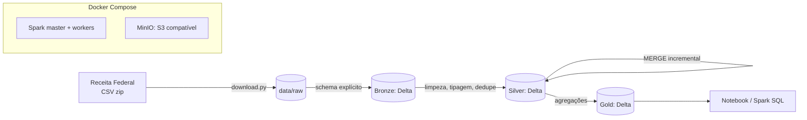

# spark-cnpj-lakehouse

Lakehouse em camadas (bronze, silver, gold) com **Apache Spark 3.5** e **Delta Lake** sobre os Dados Abertos de CNPJ da Receita Federal.

> Status: 🚧 em desenvolvimento (Épico 1: Fundações)

## Problema
Processar grandes volumes de dados cadastrais de forma distribuída, confiável e performática, com histórico auditável.

## Arquitetura


## Como rodar (3 comandos)
```bash
make up                         # sobe Spark + MinIO
make download COMPETENCIA=2026-09
make run
```

## Resultados medidos
_A preencher após o Épico 6 (ver `docs/benchmark.md`)._

## Decisões
Ver [`docs/adr/`](docs/adr/).

## Limitações e LGPD
Dados públicos, com CPF de sócios parcialmente mascarado pela fonte. É proibido tentar reidentificar pessoas, e os dados brutos **não** são republicados neste repositório (RST-01).
