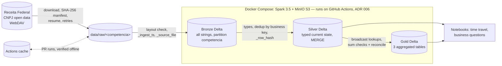

# spark-cnpj-lakehouse

[](https://github.com/thalesreiser/spark-cnpj-lakehouse/actions/workflows/ci.yml)


[](LICENSE)

> A layered lakehouse (bronze → silver → gold) built with **Apache Spark** and **Delta Lake** on the Brazilian Federal Revenue Service (Receita Federal) CNPJ open data, with incremental `MERGE` loads, auditable history, data quality checks and a same-runner benchmark that **halved the main job runtime (−50.1%)**.

**Status:** epics 1–6 done · epic 7 (publication) 🚧 finishing — see [Roadmap](#roadmap)

---

## The problem in one paragraph

The Receita Federal publishes the national company registry every month: tens of millions of companies and establishments, plus partners and lookup tables, as zipped, untyped, Latin-1 CSV files whose URL and layout have changed before. It is a realistic distributed-processing case: a volume that does not fit comfortably in one machine's memory, dirty data (alphanumeric CNPJs from 2026, invalid dates), composite keys and monthly full snapshots that must be turned into an incremental, reproducible history. This project shows the full data engineering cycle on it: **ingest** with an explicit schema and lineage, **clean and model** in tested layers, **update incrementally** without duplicates, and **measure, optimize and prove** the gain with Spark UI evidence — at zero cloud cost.

## Architecture



| Layer | Content | Guarantee (tested) |
|---|---|---|
| **Bronze** | CSVs as received, every column a string, `_ingest_ts`, `_source_file`, partitioned by `competencia` ([ADR 008](docs/adr/008-bronze-all-strings-typed-in-silver.md)) | Source lines = bronze rows; a layout change fails the run; a re-run replaces the month |
| **Silver** | Typed and normalized current state per business key, loaded by Delta `MERGE` ([ADR 011](docs/adr/011-silver-current-state-merge.md)) | No duplicated key; valid dates typed; re-running a month changes nothing; quality rules block on `error` |
| **Gold** | Establishments by CNAE × UF × opening year, companies by size, establishments by status × sector ([ADR 012](docs/adr/012-gold-aggregations-and-counting-rules.md)) | Totals reconcile with silver, recomputed independently |

Context, containers and components (simplified C4): [`docs/04-architecture.md`](docs/04-architecture.md).

**Stack:** Spark 3.5.9 (PySpark, AQE) · Delta Lake 3.3.3 · MinIO (S3 API) · Docker Compose · Python 3.11 · pytest + chispa · ruff, black, mypy strict, pre-commit, gitleaks · GitHub Actions.

## How to run

```bash
git clone https://github.com/thalesreiser/spark-cnpj-lakehouse.git && cd spark-cnpj-lakehouse
make up                       # builds the Spark image, starts Spark + MinIO, creates the bucket
make run COMPETENCIA=2026-09  # the whole pipeline for one release month
```

Needs Docker with Compose v2, GNU make and ~8 GB of RAM; `make down` stops the stack. `COMPETENCIA` is the release month (YYYY-MM). `make download` fetches only the lookup tables by default; widen with `FILES="lookups Empresas1"` or `FILES=all` (~7.8 GB zipped, ~29 GB unzipped), or set `SPARK_SAMPLE_FRACTION=0.1` for a deterministic sample. Unit tests need only Python 3.11 and Java 17: `make install && make test`.

**Where the heavy runs happen.** The development laptop cannot host the stack and the data, so GitHub Actions is the execution environment ([ADR 006](docs/adr/006-ci-as-execution-environment.md)): the `CI` workflow on every pull request, and the manual `Benchmark`, `Gold analysis` and `Download` workflows for real-data runs. Artifacts and job summaries hold counts and metrics only.

<details>
<summary>Step-by-step targets and options</summary>

| Target | What it does |
|---|---|
| `make download COMPETENCIA=… FILES=…` | Downloads and unzips into `data/raw/<COMPETENCIA>/`, writes `manifest.json` (size, SHA-256); resumes with HTTP `Range`, retries, skips files that still match. `FILES`: `lookups` (default), `empresas`, `estabelecimentos`, `socios`, `simples`, `all` or file names. Source URL and behaviour: [`docs/data-source.md`](docs/data-source.md) ([ADR 007](docs/adr/007-cnpj-source-nextcloud-webdav.md)); override with `CNPJ_BASE_URL` |
| `make bronze` / `make bronze-check` | Layout check, explicit all-string read, metadata, Delta write by `competencia`; source lines == bronze rows |
| `make silver` / `make silver-check` | Types (CNPJ incl. alphanumeric, [ADR 009](docs/adr/009-alphanumeric-cnpj-and-invalid-values.md)), one current record per key, `MERGE`; no duplicated key, dates typed |
| `make quality` | Declarative null, domain, reference, pattern and uniqueness rules; fails on `error` ([rules](docs/data-dictionary.md#quality-rules)) |
| `make gold` / `make reconcile` | Three gold tables with sum checks; independent silver × gold reconciliation by total, UF, status, size and grain |
| `make time-travel` | `DESCRIBE HISTORY`, version N-1 by `versionAsOf` and `timestampAsOf` vs N ([notebook 01](notebooks/01-time-travel.ipynb)) |
| `make optimize` / `make vacuum` | Compaction to ~128 MiB ([ADR 004](docs/adr/004-target-file-size.md)); `VACUUM` keeps 35 days, refused below 7 ([ADR 013](docs/adr/013-table-maintenance-and-vacuum-retention.md)) |
| `make benchmark` | Main job 3 times with Spark event logs ([method](docs/benchmark.md#method)) |
| `make lint` / `make test` | ruff, black, mypy strict; pytest, fails below 80% coverage |

Every job writes a JSON/Markdown summary of counts to `build/`. Local endpoints: Spark UI http://localhost:8080, MinIO console http://localhost:9001 (dev credentials from `.env.example`, never committed). Image and version choices: [ADR 005](docs/adr/005-docker-environment-images.md).

</details>

## Results

| What | Result | Evidence |
|---|---|---|
| **Main job runtime** (silver `MERGE` + gold, 25% sample of `Empresas1` + `Estabelecimentos1`, median of 3) | **481.9 s → 240.6 s (−50.1%)**, target ≥ 30%; tasks 1,980 → 368 (−81.4%); spill −22% (memory) / −17% (disk); identical silver and gold tables | Before and after measured in the same job on the same runner (AMD EPYC 7763), run [39975706499](https://github.com/thalesreiser/spark-cnpj-lakehouse/actions/runs/39975706499); [`docs/benchmark.md`](docs/benchmark.md#before--after-task-64), [Spark UI screenshots](docs/img/benchmark) |
| **Reads after `OPTIMIZE`** | Files per bronze partition 3–12 → 1; silver read workload (5 queries) 4.27 s → 2.57 s (−39.8%), same fingerprints | [`docs/benchmark.md`](docs/benchmark.md#optimize-and-vacuum-task-63) |
| **Quality and reconciliation** | Bronze rows = source lines; 0 duplicated business keys; gold sums = silver rows and an independent silver × gold reconciliation, on real data in every PR (size table) and on 4,753,435 real establishments in the `Gold analysis` run | CI `bronze` job; run [39433114188](https://github.com/thalesreiser/spark-cnpj-lakehouse/actions/runs/39433114188) |
| **Idempotency** | Re-running a loaded month: 0 inserted, 0 updated, identical table fingerprint (row count + order-independent SHA-256) before and after, printed in the job summary | `tests/test_silver_idempotency.py`; CI `bronze` job |
| **Time travel** | After a second (synthetic) month, version N-1 read by `versionAsOf` and `timestampAsOf` reproduces the aggregates recorded after the first load | `tests/test_time_travel.py`; CI `bronze` job; [notebook 01](notebooks/01-time-travel.ipynb) |
| **Tests and coverage** | 326 tests (unit, chispa and Delta tests on a versioned synthetic release); 86.6% line coverage, gate 80% | CI `lint-test` job |
| **CI** | Three required checks on every PR: `lint-test`, `smoke` (stack up + Delta round trip on MinIO), `bronze` (real 2026-09 subset from the Actions cache, SHA-256 verified, through the whole pipeline); a monthly live check downloads the latest month and opens an issue on failure | [`ci.yml`](.github/workflows/ci.yml), [`download.yml`](.github/workflows/download.yml) |

What moved the needle (CNPJ check digits over a helper column, 16 MB input splits, fewer Delta snapshot partitions, executor memory) and why an earlier −63.1% figure was discarded (two CPU models): [`docs/benchmark.md`](docs/benchmark.md#diagnosis-r-p2-02). Every acceptance criterion and its run: [`docs/05-validation.md`](docs/05-validation.md).

## Business insights (teaser)

From [`notebooks/02-business-questions.ipynb`](notebooks/02-business-questions.ipynb), executed by the `Gold analysis` workflow on `lookups` + `Empresas1` + `Estabelecimentos1` of 2026-09. **Caveat:** the release splits records by CNPJ range, so this sample covers the older part of the registry (openings stop in 2021); only shares and rankings are meaningful, not national totals.

- Openings in 2021–2025 concentrate in the South-East and South (**SP 28.8%**, MG 10.7%, RJ 9.6%), led by micro-entrepreneur activities such as clothing retail and beauty services.
- Active establishments: **South-East 52.5%**, with a similar active rate across regions — the ranking reflects where companies are, not regional survival.
- **74.7%** of the sampled establishments are closed or unfit; trade concentrates 36.6% of them, and health (84.3%) and accommodation/food (82.8%) have the highest closure rates within the sector.

## Limitations

- **Sample, not the full release.** Benchmarks and analyses use one or two of the ten files per table, and the files are split by CNPJ range (not random), so absolute numbers are partial. The whole release (~29 GB unzipped) was never run: it does not fit the 14 GB disk of a GitHub runner ([ADR 006](docs/adr/006-ci-as-execution-environment.md)).
- **Runner variance.** GitHub assigns the runner CPU; between jobs the same code varied by ~5–10%. The headline −50.1% compares both versions inside one job for that reason.
- **Record linkage (RF-10) not implemented** — a "Could" item left out by MoSCoW.
- **Single-command run.** `make run` (`cnpj_lakehouse.pipeline`) is the single entry point; until it is wired up in `main`, the steps run as one `make` target each, exactly as CI runs them.
- **Source availability.** The Receita Federal portal has moved and gone offline before; PR runs use the Actions cache (evicted after 7 days unused), so a portal outage with a cold cache still fails a run.
- **LGPD.** Only aggregates, counts and metadata leave the pipeline; no raw data is committed; fixtures are synthetic and verified absent from the real registry. Partner CPFs come partially masked by the source, and re-identification is forbidden ([`USAGE-POLICY.md`](USAGE-POLICY.md)).

## Documentation

| Document | Content |
|---|---|
| [01 Vision and scope](docs/01-vision-and-scope.md) · [02 Analysis](docs/02-analysis-and-prioritization.md) · [03 Specification](docs/03-specification.md) | Problem and metrics; requirements (MoSCoW), rules and risks; Gherkin scenarios and data model |
| [04 Architecture](docs/04-architecture.md) · [05 Validation](docs/05-validation.md) · [06 Traceability](docs/06-traceability.md) | Simplified C4; acceptance criteria with evidence; requirement → component → test |
| [Benchmark](docs/benchmark.md) · [Data dictionary](docs/data-dictionary.md) · [Data source](docs/data-source.md) | Method and before × after; tables, columns, types, quality rules; URL, layout and volumes |
| [ADRs](docs/adr/) | [001](docs/adr/001-storage-format-csv-parquet-delta.md) storage format · [002](docs/adr/002-partitioning-by-month-and-state.md) partitioning · [003](docs/adr/003-broadcast-join-for-lookup-tables.md) broadcast joins · [004](docs/adr/004-target-file-size.md) file size · [005](docs/adr/005-docker-environment-images.md) images · [006](docs/adr/006-ci-as-execution-environment.md) CI as runtime · [007](docs/adr/007-cnpj-source-nextcloud-webdav.md) data source · [008](docs/adr/008-bronze-all-strings-typed-in-silver.md) bronze strings · [009](docs/adr/009-alphanumeric-cnpj-and-invalid-values.md) alphanumeric CNPJ · [010](docs/adr/010-invalid-and-all-zero-cnpj-in-silver.md) invalid CNPJ · [011](docs/adr/011-silver-current-state-merge.md) silver MERGE · [012](docs/adr/012-gold-aggregations-and-counting-rules.md) gold rules · [013](docs/adr/013-table-maintenance-and-vacuum-retention.md) maintenance |

Repository layout: `src/cnpj_lakehouse/` (one module per step), `tests/` (+ synthetic release fixture), `notebooks/`, `infra/` (Compose and Spark image), `scripts/` (checks, benchmark, exports), `docs/`, `.github/workflows/`.

## Roadmap

| Epic | Deliverable | Status |
|---|---|---|
| 1. Foundations | Repository, Docker environment, vision and requirements | ✅ |
| 2. Bronze ingestion | Parameterized download, schemas, Delta with metadata | ✅ |
| 3. Silver and quality | Normalization, deduplication, tests, quality checks | ✅ |
| 4. Incremental and history | MERGE, idempotency, time travel | ✅ |
| 5. Gold and analysis | Aggregations, reconciliation, notebook | ✅ |
| 6. Optimization and benchmark | Baseline, tuning, OPTIMIZE/VACUUM, `benchmark.md` | ✅ |
| 7. Publication | CI, diagrams, ADRs, traceability, final README | 🚧 |

## Data, license and usage

Source: **Receita Federal do Brasil — Cadastro Nacional da Pessoa Jurídica (CNPJ), Dados Abertos** ([`docs/data-source.md`](docs/data-source.md)), downloaded at run time and not redistributed. The only data files in the repository are aggregated counts in `notebooks/data/` and synthetic test fixtures. Receita Federal's terms apply to the data; the code is under the [MIT](LICENSE) license (keep the copyright notice of **Thales Reiser Pedreira**). Data and security rules: [`USAGE-POLICY.md`](USAGE-POLICY.md), [`SECURITY.md`](SECURITY.md).

## Related projects

| # | Project | Focus |
|---|---|---|
| **P2** | **spark-cnpj-lakehouse** (this one) | Distributed processing with Spark and Delta Lake |
| P1 | [aws-fundos-pipeline](https://github.com/thalesreiser/aws-fundos-pipeline) | AWS pipeline with Terraform, Airflow and CI/CD |
| P3 | [dbt-dw-api](https://github.com/thalesreiser/dbt-dw-api) | Data warehouse with dbt, data quality and a REST API |

## Author

**Thales Reiser Pedreira**, Data and Software Engineer · Python, SQL, AWS and Big Data.
[GitHub](https://github.com/thalesreiser) · [LinkedIn](https://www.linkedin.com/in/thalesreiserpedreira)
