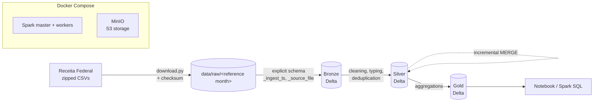

# spark-cnpj-lakehouse

[](https://github.com/thalesreiser/spark-cnpj-lakehouse/actions/workflows/ci.yml)


[](LICENSE)

> A layered lakehouse (bronze → silver → gold) built with **Apache Spark** and **Delta Lake** on top of the Brazilian Federal Revenue Service (Receita Federal) CNPJ open data, with incremental loads, auditable history and a documented benchmark of the performance gain obtained through tuning.

**Status:** 🚧 in progress · epic 2 of 7 (bronze ingestion)

---

## Why this project exists

The Receita Federal CNPJ registry is one of the largest public datasets in Brazil: tens of millions of companies and establishments, plus partners and lookup tables (CNAE activity codes, municipalities, legal natures), published as compressed, untyped CSV files. It is a realistic case for distributed processing: a volume that does not fit comfortably in a single machine's memory, dirty data, composite keys and periodic updates.

The goal is not just "running Spark", but showing the full cycle of a data engineer:

- **Ingest** with an explicit schema and lineage metadata
- **Clean and model** in layers with testable rules
- **Update incrementally** without duplicates (MERGE)
- **Measure, optimize and prove** the gain with numbers from the Spark UI

## Technical highlights

| Topic | What is demonstrated |
|---|---|
| **Delta Lake** | ACID transactions, incremental `MERGE`, *time travel* (querying version N-1), schema evolution, `OPTIMIZE` and `VACUUM` |
| **Spark tuning** | AQE, *broadcast join* of lookup tables, partitioning by reference month and state, file size control, `repartition` vs `coalesce` |
| **Honest benchmark** | Runtime, *shuffle*, *spill* and number of files before × after, with Spark UI evidence. Target: **at least 30% reduction** in the main job |
| **Data quality** | Uniqueness, null, domain and silver × gold reconciliation checks |
| **Software engineering** | Transformations as pure functions, `chispa` tests, CI, pre-commit, ADRs |
| **Portability** | Everything runs with Docker Compose (Spark + MinIO with an S3 API), with no cloud cost |

## Architecture



| Layer | Content | Guarantee |
|---|---|---|
| **Bronze** | CSVs as received, with an explicit schema + `_ingest_ts` and `_source_file` | Source row count = target row count |
| **Silver** | Typed, normalized data, deduplicated on the business key | No duplicated CNPJ; 100% of valid dates typed as `date` |
| **Gold** | Companies by CNAE, state, year of opening, size and registration status | Totals reconcile with silver |

### Did you know? The anatomy of a CNPJ

A CNPJ (the Brazilian company tax ID) has 14 digits split into three parts, and that is how the establishment business key is built (rule **RN-01**):

```
12.345.678 / 0001 - 95
└── base ──┘ └order┘ └check┘
  company    head     check
             office   digits
             or branch
```

The first 8 digits identify the **company**; order `0001` is usually the head office and the others are branches. That is why the dataset comes split into "companies" (by base CNPJ) and "establishments" (by full CNPJ), and the join between them is one of the tuning points of the project.

### Questions the gold layer answers

- How many companies were opened per year in each state and sector (CNAE)?
- How are active companies distributed by size in each region?
- Which sectors have the highest share of closed or inactive companies?

The notebook [`notebooks/02-business-questions.ipynb`](notebooks/02-business-questions.ipynb) answers them with charts on a real release subset (see [Gold](#gold-rf-05)).

## Stack

| Layer | Technology | Why |
|---|---|---|
| Processing | Apache Spark 3.5 (PySpark), AQE enabled | Industry standard for large volumes |
| Table format | Delta Lake | ACID, MERGE, time travel, schema evolution |
| Storage | MinIO (S3 API, maintained `pgsty/minio` fork) | The same code later runs on AWS, at no cost |
| Orchestration | Makefile + scripts | Simple and reproducible (Airflow is covered in [P1](https://github.com/thalesreiser/aws-fundos-pipeline)) |
| Tests | pytest + chispa | DataFrame comparison |
| Code quality | ruff, black, mypy, pre-commit, gitleaks | Standard shared by the 3 projects |
| CI | GitHub Actions | Lint + tests + Docker environment smoke test; also the execution environment for heavy runs ([ADR 006](docs/adr/006-ci-as-execution-environment.md)) |

## How to run

### Where things run

| Where | What |
|---|---|
| **Your machine** | Editing, `make lint`, `make test` (unit tests with small DataFrames; needs Python 3.11 and Java 17, no Docker) |
| **CI on every pull request** | Lint, type-check, tests; the `smoke` job, which builds the image, brings up Spark + MinIO and writes/reads a Delta table; and the `bronze` job, which ingests a real release subset into bronze and reconciles the row counts |
| **Manual workflows** | Heavy runs: the `Download` workflow (a reference month from the real source, manifest as an artifact); the `Benchmark` workflow (main job 3 times, metrics, Spark event logs and Spark UI pages as artifacts, [`docs/benchmark.md`](docs/benchmark.md)) |

### Continuous integration

The `CI` workflow ([`.github/workflows/ci.yml`](.github/workflows/ci.yml)) runs on every pull request and on every push to `main`; its three jobs run in parallel and are required checks for merging. A new push to a pull request cancels the run still in progress.

| Job | What it runs | Data | Typical time |
|---|---|---|---|
| `lint-test` | `make lint` (ruff, black `--check`, mypy strict on `src`, `scripts` and `infra`), then `make test`: unit tests, then the Delta tests that load the versioned synthetic release (`tests/fixtures/release`) bronze → silver → gold (`test_bronze_counts`, `test_silver_merge`, `test_silver_idempotency`, `test_gold_delta`, `test_time_travel`); fails below 80% coverage | Synthetic fixture and in-memory DataFrames | ~11 min |
| `smoke` | Builds the Spark image, brings up MinIO + Spark (Docker Compose) and writes/reads a Delta table over s3a | None | ~1.5 min |
| `bronze` | Restores `lookups` + `Empresas1` of 2026-09 from the Actions cache (or downloads them on a miss), verifies every SHA-256 against the manifest and runs bronze, silver (+ re-run and a synthetic next month), quality, time travel, gold and reconcile on the Docker stack; only counts are published | Real release subset | ~24 min |

pip downloads are cached by `actions/setup-python` (keyed on `pyproject.toml`).

**Raw-file cache.** The `bronze` job does not depend on the Receita Federal portal being up: it restores `data/raw/<COMPETENCIA>/` with `actions/cache/restore` (key `cnpj-raw-<COMPETENCIA>-<hash of FILES>-<hash of download.py>`, so a downloader change invalidates it), then runs `python -m cnpj_lakehouse.download ... --verify-only`, which fails the job if any zip or extracted file is missing or its size/SHA-256 differs from `manifest.json`. Only pushes to `main` save the cache (`actions/cache/save`); pull requests restore main's cache and never create one. On a miss the files are downloaded as before, so a portal outage combined with a cold cache (GitHub evicts entries unused for 7 days; 10 GB per repository) still fails the job.

**Monthly live check.** The `monthly-check` job of the [`Download`](.github/workflows/download.yml) workflow runs on day 15 (`23 9 15 * *`) and on demand (`monthly_check: true`, optional `competencia`). It finds the most recent month published on the portal that already holds every needed file ([`scripts/latest_competencia.py`](scripts/latest_competencia.py), a WebDAV `PROPFIND` listing), downloads `lookups Empresas1 Estabelecimentos1` straight from the portal and runs bronze, bronze-check, silver, silver-check, quality, gold and reconcile; the job summary holds counts only. On failure it opens an issue labelled `monthly-check` with the failing step and the run link, or comments on the open one.

The reasons are in [ADR 006](docs/adr/006-ci-as-execution-environment.md). The whole stack can still run locally if you have Docker:

### Run the Docker stack locally (optional)

**Prerequisites:** Docker Desktop (Windows/macOS) or Docker Engine with the Compose v2 plugin (Linux); GNU make (on Windows: `winget install ezwinports.make`); about 8 GB of RAM for the defaults (1 worker with 2 cores and 2 GB, 1 GB executors; adjust `SPARK_WORKER_MEMORY`/`SPARK_WORKER_CORES` in `.env`).

```bash
cp .env.example .env   # optional: MinIO dev credentials and Spark resources
make up                # builds the Spark image, starts MinIO + Spark master/worker and creates the bucket
make smoke             # writes and reads a Delta table on MinIO (s3a://lakehouse/_smoke/...)
make down              # stops everything (make down V=1 also deletes the MinIO volume)
```

`make up` waits for the *healthchecks* (MinIO alive, master up and worker registered) and creates the `lakehouse` bucket with `mc`. The first `make up` takes a few minutes to build the image. Other targets: `make ps` (service status) and `make logs`.

| Service | Address |
|---|---|
| Spark master (UI) | http://localhost:8080 |
| Spark worker (UI) | http://localhost:8081 |
| Spark master (cluster) | `spark://localhost:7077` |
| MinIO S3 API | http://localhost:9000 |
| MinIO console | http://localhost:9001 (user/password from `.env`; dev default `minioadmin`) |

Spark applications run in the `spark-client` service, which uses the same image as the executors (Python 3.11, Spark 3.5.9, Delta 3.3.3, hadoop-aws 3.3.4). The reasons are in [ADR 005](docs/adr/005-docker-environment-images.md). In the code, the session comes from `cnpj_lakehouse.spark.get_spark("app-name")`, configured through environment variables (`S3_ENDPOINT`, `S3_ACCESS_KEY`, `S3_SECRET_KEY`, `LAKEHOUSE_BUCKET`, `SPARK_MASTER_URL`).

> The MinIO credentials in `.env.example` and in CI are for local development only. `.env` is never committed.

### Pipeline

```bash
make download COMPETENCIA=2026-09                            # lookup tables only (safe default, a few KB)
make download COMPETENCIA=2026-09 FILES="lookups Empresas1"  # a subset
make download COMPETENCIA=2026-09 FILES=all                  # the whole release (~7.8 GB zipped, ~29 GB unzipped)
make run                                                      # bronze → silver → gold
```

`COMPETENCIA` is the reference month (YYYY-MM) of the Receita Federal release, kept with its domain name. `make download` (RF-01) fetches the zips into `data/raw/<COMPETENCIA>/`, unzips them there and writes `manifest.json` with the source URL, size, SHA-256, download time and extracted files of each zip. It retries transient errors with backoff, resumes partial downloads with HTTP `Range`, and skips files that still match the manifest, so re-runs are idempotent. `FILES` accepts groups (`empresas`, `estabelecimentos`, `socios`, `simples`, `lookups`, `all`) and file names (`Empresas0`, `Cnaes`, ...). It defaults to `lookups`, so downloading the whole release always requires an explicit `FILES=all` (a protection for machines and runners with little disk). The same options exist on the CLI:

```bash
python -m cnpj_lakehouse.download --competencia 2026-09 --files lookups [--dest data/raw] [--base-url URL]
```

The source moved to a Nextcloud share in 2026; the current URL, layout, volumes and server behaviour are in [`docs/data-source.md`](docs/data-source.md) ([ADR 007](docs/adr/007-cnpj-source-nextcloud-webdav.md)). If it moves again, set `CNPJ_BASE_URL` (or `--base-url`). On GitHub, the manual **Download** workflow (`Actions → Download → Run workflow`, inputs `competencia` and `files`) downloads a release on a runner and publishes only `manifest.json` and a file listing as an artifact, never the raw data.

#### Bronze ingestion (RF-02)

```bash
make up
make bronze COMPETENCIA=2026-09                        # every table downloaded for the month
make bronze COMPETENCIA=2026-09 TABLES="empresas cnaes" # a subset
make bronze-check COMPETENCIA=2026-09                  # source line counts == bronze row counts
```

`make bronze` runs `python -m cnpj_lakehouse.bronze` in the `spark-client` container (the Spark worker mounts the repository read-only, so executors read `data/raw/` at the same path). For each table listed in `manifest.json` it:

1. **checks the layout:** counts the `;`-separated fields of every raw line, ignoring `;` inside quoted values (doubled quotes honoured). With a fixed schema Spark would silently drop extra fields and null missing ones, so any line with a different field count fails the run and the log shows the field-count histogram and examples (`--max-bad-lines N` tolerates N lines; [ADR 008](docs/adr/008-bronze-all-strings-typed-in-silver.md));
2. reads the CSVs with the explicit bronze schema (every column a string, no `inferSchema`) and adds `_ingest_ts` (one UTC timestamp per run), `_source_file` (path of the source CSV) and `competencia`;
3. samples the rows when `SPARK_SAMPLE_FRACTION` < 1 (fixed seed, so the sample is reproducible; RNF-03);
4. writes Delta to `s3a://<bucket>/bronze/<table>/`, partitioned by `competencia`; re-running a month replaces its partition (`replaceWhere`), never duplicates it ([ADR 002](docs/adr/002-partitioning-by-month-and-state.md));
5. logs rows read and written (and whether sampling was applied) and writes a summary to `build/bronze-<COMPETENCIA>.json`.

On every pull request the CI `bronze` job downloads `lookups` + `Empresas1` of 2026-09, ingests them, re-runs two tables and checks with `scripts/bronze_check.py` that every bronze partition has exactly as many rows as its source CSVs have lines, with `_ingest_ts` and `_source_file` always filled. It publishes only the counts (job summary and artifact).

#### Silver: types, deduplication and incremental MERGE (RF-03, RF-04)

```bash
make silver COMPETENCIA=2026-09                         # every bronze table with rows for the month
make silver COMPETENCIA=2026-09 TABLES="empresas cnaes"  # a subset
make silver-check COMPETENCIA=2026-09                   # no duplicated business key, dates typed
make quality COMPETENCIA=2026-09                        # nulls, domains, uniqueness; fails on `error` rules
```

`make silver` runs `python -m cnpj_lakehouse.silver` in the `spark-client` container. For each table it reads the month's bronze partition, applies the documented types (CNPJ incl. alphanumeric, CNAE, dates, money; [ADR 009](docs/adr/009-alphanumeric-cnpj-and-invalid-values.md)), discards rows without a business key, keeps **one current record per business key** with a window function (RN-01 base + order + DV for `estabelecimentos`, `cnpj_basico` for `empresas` and `simples`, a natural key for `socios`, `codigo` for the lookups; a later release, then the most recent relevant date, then `_ingest_ts`, with a deterministic final tie-breaker) and **merges** them into the Delta table `s3a://<bucket>/silver/<table>/`, which holds the current state of every key across months: new keys are inserted, keys whose content hash changed are updated, absent keys are kept and a re-run of the same month changes nothing ([ADR 011](docs/adr/011-silver-current-state-merge.md)). Establishments get `cnpj` and a `cnpj_valido` flag; invalid CNPJs are kept flagged by default (`--invalid-cnpj drop` discards them; [ADR 010](docs/adr/010-invalid-and-all-zero-cnpj-in-silver.md), proposed). Rows in and out, duplicates removed, rows without key, invalid CNPJs, date parse failures and the MERGE metrics (inserted, updated, unchanged, table version) are logged and written to `build/silver-<COMPETENCIA>.json`. The keys and ordering per table are in the [data dictionary](docs/data-dictionary.md#silver-keys-and-current-record).

The CI `bronze` job then runs `make silver` on the same 2026-09 subset and `scripts/silver_check.py`, which fails if any business key appears twice, if a date column is not typed `date` or if a valid source date was lost. It then re-runs the month (expects 0 inserted, 0 updated) and loads a synthetic next month derived from the same bronze (`scripts/silver_next_month.py`), expecting the changed keys to be updated, the new ones inserted and no key duplicated.

`make quality` runs `python -m cnpj_lakehouse.quality` on the silver tables (the whole current state, ADR 011; `COMPETENCIA` labels the report): declarative rules per table check mandatory columns (nulls), coded columns against the documented domains (UF, registration status, company size...) and the silver lookup tables, identifier formats and business-key uniqueness. It writes `build/quality-<COMPETENCIA>/quality.md` and `quality.json` (counts only) and exits non-zero when any `error` rule fails; `warn` rules (e.g. invalid CNPJs, codes missing from a lookup) are reported only. The CI `bronze` job runs it last and appends the report to the job summary. The rules are listed in the [data dictionary](docs/data-dictionary.md#quality-rules).

**Idempotency guarantee (RF-04).** Re-running `make silver` for a month that is already loaded leaves every silver table identical: the MERGE inserts and updates nothing, and the table fingerprint (`cnpj_lakehouse.fingerprint.table_fingerprint`: row count plus an order-independent SHA-256 of every column except the load metadata `_ingest_ts`/`_source_file`) is the same before and after. A new month changes only the keys it updates or inserts, re-running it is again a no-op, and loading an older month never overwrites a newer record. This is proven by `tests/test_silver_idempotency.py` and on real data by the CI `bronze` job, which prints both fingerprints of the re-run in its job summary.

#### Time travel (RF-06)

```bash
make time-travel                                         # silver empresas: history, N-1 vs N
make time-travel TT_ARGS="--snapshot build/before.json"  # record the current version
make time-travel TT_ARGS="--expected build/before.json"  # later: N-1 must reproduce it
```

Every silver load is one Delta version ([ADR 011](docs/adr/011-silver-current-state-merge.md)), so the state after an earlier run can be read back. `python -m cnpj_lakehouse.time_travel` runs `DESCRIBE HISTORY`, reads version N-1 with `versionAsOf` and with `timestampAsOf` (the N-1 commit timestamp), compares it with version N (rows, counts per `porte_empresa` / `natureza_juridica`, keys whose `_row_hash` changed) and fails if N-1 does not reproduce the aggregates recorded right after that run. It writes only aggregates and metadata to `build/time-travel/` (RST-01). The CI `bronze` job records `empresas` after the 2026-09 load, runs the demo after the synthetic 2026-10 month and publishes the report in the job summary. The notebook [`notebooks/01-time-travel.ipynb`](notebooks/01-time-travel.ipynb) walks through the three queries and explains that result.

#### Gold (RF-05)

```bash
make gold COMPETENCIA=2026-09   # silver current state -> gold tables; fails if a sum check fails
make reconcile COMPETENCIA=2026-09   # gold totals == silver recomputed independently
```

`make gold` runs `python -m cnpj_lakehouse.gold` on the whole silver tables (the current state, [ADR 011](docs/adr/011-silver-current-state-merge.md); `COMPETENCIA` labels the summary) and writes three Delta tables under `s3a://<bucket>/gold/`: `gold_empresas_cnae_uf_ano` (establishments by main CNAE, state and opening year), `gold_distribuicao_porte` (companies by size, with share) and `gold_situacao_setor` (establishments by registration status and CNAE section/division). Lookups are joined with a broadcast hint ([ADR 003](docs/adr/003-broadcast-join-for-lookup-tables.md)); each table is overwritten whole on every run, since gold is derived. Establishments with an invalid CNPJ are counted (`--exclude-invalid-cnpj` leaves them out) and null codes form their own group, so the gold sums equal the silver rows: the run checks it and exits non-zero otherwise ([ADR 012](docs/adr/012-gold-aggregations-and-counting-rules.md)). It writes only row counts and the sum checks to `build/gold-<COMPETENCIA>.json` / `.md`. The tables and columns are in the [data dictionary](docs/data-dictionary.md#gold-tables). The CI `bronze` job loads no `Estabelecimentos` file, so it builds only `gold_distribuicao_porte` on real data; the other two run end to end on Delta in `tests/test_gold_delta.py`.

`make reconcile` (`python -m cnpj_lakehouse.reconcile`, task 5.2) is the independent silver x gold proof: it recomputes every gold measure straight from silver with its own expressions (never the gold aggregation functions) and compares it with the gold Delta tables at several levels: the grand total, by UF (`gold_empresas_cnae_uf_ano`), by registration status (`gold_situacao_setor`), by size (`gold_distribuicao_porte`) and at the gold grain, where the non-additive `empresas` columns are compared with a `countDistinct` on silver instead of being summed. It follows ADR 012 (invalid CNPJs counted unless `--exclude-invalid-cnpj`, which must match the gold run; null codes matched as their own group) and writes per-group counts only to `build/reconcile/reconcile.json` / `.md`; any mismatching group, or a gold table without its silver input (or the reverse), exits with code 1. CI runs it right after `make gold`: on the real subset it covers the size table; the UF and status breakdowns are proven on synthetic data (`tests/test_reconcile.py`, including deliberately broken gold tables, and on Delta in `tests/test_gold_delta.py`).

Business questions (task 5.3): the manual **Gold analysis** workflow (`.github/workflows/gold-analysis.yml`, `workflow_dispatch` only) loads `lookups` + `Empresas1` + `Estabelecimentos1` by default (`files` input), runs bronze, silver and gold, exports small roll-ups of the gold tables (`scripts/gold_export.py`: counts by year/UF, CNAE, size, status x sector; no rows) and executes [`notebooks/02-business-questions.ipynb`](notebooks/02-business-questions.ipynb) on them (`pip install -e ".[notebooks]"`). To regenerate: `gh workflow run gold-analysis.yml -f competencia=2026-09`, download the `gold-analysis-<COMPETENCIA>` artifact and copy `notebooks/` over the repository. One `Estabelecimentos` file is a sample of the release, so only shares and rankings are meaningful.

Performance baseline (RF-08, task 6.1): the manual `Benchmark` workflow runs the **main job** (the monthly silver `MERGE` + gold) 3 times on a real release subset and records the median time, shuffle, spill, tasks and files per table, read from Spark event logs (`SPARK_EVENT_LOG_DIR`, parsed by `cnpj_lakehouse.benchmark`); the Spark UI of the median run is rebuilt by a History Server and uploaded with the event logs. `make benchmark BENCH_ARGS="--next 2026-10 --merge-tables empresas"` runs it on the local stack (after `make bronze` and `scripts/silver_next_month.py`). Tuning (task 6.2) took the main job from 459.7 s to 169.8 s (−63.1%, same results); what each change did is in the same page. Results and method: [`docs/benchmark.md`](docs/benchmark.md).

Table maintenance (RF-07, task 6.3): `make optimize` (`python -m cnpj_lakehouse.maintenance optimize`: compaction of the large tables of `LAYER`, default silver, to ~128 MiB files, [ADR 004](docs/adr/004-target-file-size.md); `MAINT_ARGS="--where \"competencia = '2026-10'\""` limits bronze to one month) and `make vacuum` (`RETENTION_HOURS`, default 840 h = 35 days so the previous monthly version stays readable by time travel; refused below 168 h, [ADR 013](docs/adr/013-table-maintenance-and-vacuum-retention.md)). Both write a JSON summary of files and bytes to `build/`. On the benchmark sample, compaction took the bronze partitions from up to 12 files to 1 and silver from 5/13 files to 1/2, and the silver read workload from 4.37 s to 2.89 s (−34%), with identical fingerprints.

For development: `make install` (dependencies + pre-commit hooks), `make lint` and `make test` (fails below 80% coverage, RF-09). On Windows without `HADOOP_HOME`/winutils the Spark write tests are skipped, so coverage can fall below the threshold: run `pytest` (no threshold) or `make test COVERAGE_MIN=0` locally and rely on CI (Linux) for the enforced run. Limited memory? Set `SPARK_SAMPLE_FRACTION=0.1` in `.env` to process 10% of the data (RNF-03).

## Repository layout

```
├── src/cnpj_lakehouse/   # download, schemas, bronze, silver, gold, pipeline, Spark session and versions
├── tests/                # unit tests (small DataFrames) and fixtures
├── notebooks/            # time travel and business questions
├── infra/                # docker-compose (Spark + MinIO) and the Spark image
├── scripts/              # environment smoke test
├── docs/                 # requirements (01–06), benchmark and ADRs
└── .github/workflows/    # CI and the manual Download workflow
```

## Roadmap

| Epic | Deliverable | Hours | Status |
|---|---|---|---|
| 1. Foundations | Repository, Docker environment, vision and requirements | 6 h | ✅ |
| 2. Bronze ingestion | Parameterized download, schemas, Delta with metadata | 8 h | 🚧 |
| 3. Silver and quality | Normalization, deduplication, tests, quality checks | 10 h | 🚧 |
| 4. Incremental and history | MERGE, idempotency, time travel | 7 h | ⬜ |
| 5. Gold and analysis | Aggregations, reconciliation, notebook | 5 h | 🚧 |
| 6. Optimization and benchmark | Baseline, tuning, OPTIMIZE/VACUUM, `benchmark.md` | 9 h | ⬜ |
| 7. Publication | CI, diagrams, ADRs, traceability, final README | 5 h | ⬜ |

## Measured results

_To be published at the end of epic 6 in [`docs/benchmark.md`](docs/benchmark.md), including the actual result even if the 30% target is not reached._

| Metric | Baseline | After tuning | Change |
|---|---|---|---|
| Main job runtime | — | — | — |
| Shuffle | — | — | — |
| Spill | — | — | — |
| Files per partition | — | — | — |

## Documentation

The project follows a requirements engineering process inspired by ISO/IEC/IEEE 29148:

| Document | Content |
|---|---|
| [01 - Vision and scope](docs/01-vision-and-scope.md) | Problem, goal, scope and success metrics |
| [02 - Analysis and prioritization](docs/02-analysis-and-prioritization.md) | Requirements (MoSCoW), rules, constraints and risks |
| [03 - Specification](docs/03-specification.md) | User stories in Gherkin and data model |
| [04 - Architecture](docs/04-architecture.md) | Simplified C4 |
| [05 - Validation](docs/05-validation.md) | Acceptance criteria execution |
| [06 - Traceability](docs/06-traceability.md) | Requirement → component → test |
| [Data source](docs/data-source.md) | Where the CNPJ data lives, server behaviour and release layout |
| [Data dictionary](docs/data-dictionary.md) | Tables, columns, target types and CSV format of the CNPJ open data |
| [ADRs](docs/adr/) | Architecture decisions with alternatives and consequences |

## Data and LGPD

The data is public and downloaded straight from the official source at run time: **no raw data is committed** to this repository. Partner CPFs (individual taxpayer IDs) already come partially masked by the Receita Federal, and using the project to try to re-identify people is forbidden. Details in [`USAGE-POLICY.md`](USAGE-POLICY.md).

### Data sources and attribution

Source: **Receita Federal do Brasil — Cadastro Nacional da Pessoa Jurídica (CNPJ), Dados Abertos**, downloaded from <https://arquivos.receitafederal.gov.br/public.php/dav/files/gn672Ad4CF8N6TK/Dados/Cadastros/CNPJ> ([`docs/data-source.md`](docs/data-source.md)). The data is not redistributed here. The only data files in the repository are **aggregated counts** in `notebooks/data/` (derived from the 2026-09 release, no rows or company names) and synthetic test fixtures. Receita Federal's terms apply to the data; the MIT license covers the code only.

## Related projects

This is the first of three data engineering projects developed in sequence:

| # | Project | Focus |
|---|---|---|
| **P2** | **spark-cnpj-lakehouse** (this one) | Distributed processing with Spark and Delta Lake |
| P1 | [aws-fundos-pipeline](https://github.com/thalesreiser/aws-fundos-pipeline) | AWS pipeline with Terraform, Airflow and CI/CD |
| P3 | [dbt-dw-api](https://github.com/thalesreiser/dbt-dw-api) | Data warehouse with dbt, data quality and a REST API |

## License

Code under the [MIT](LICENSE) license: it may be used, copied and modified, including commercially, as long as the copyright notice of **Thales Reiser Pedreira** is kept. Rules about data and security are in [`USAGE-POLICY.md`](USAGE-POLICY.md).

## Author

**Thales Reiser Pedreira**, Data and Software Engineer · Python, SQL, AWS and Big Data.
[GitHub](https://github.com/thalesreiser) · [LinkedIn](https://www.linkedin.com/in/thalesreiserpedreira)
