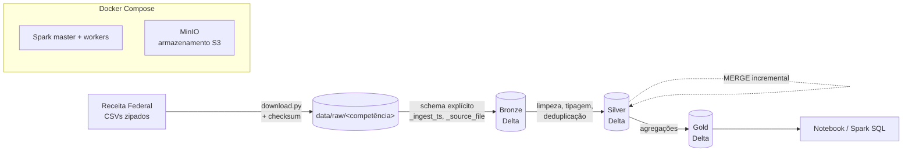

# spark-cnpj-lakehouse

[](https://github.com/thalesreiser/spark-cnpj-lakehouse/actions/workflows/ci.yml)


> Lakehouse em camadas (bronze → silver → gold) com **Apache Spark** e **Delta Lake** sobre os Dados Abertos de CNPJ da Receita Federal, com carga incremental, histórico auditável e um benchmark documentado do ganho de desempenho obtido com tuning.

**Status:** 🚧 em desenvolvimento · Épico 1 de 7 (Fundações)

---

## Por que este projeto existe

O cadastro de CNPJ da Receita Federal é uma das maiores bases públicas do Brasil: dezenas de milhões de empresas e estabelecimentos, além de sócios e tabelas auxiliares (CNAE, municípios, naturezas jurídicas), publicados como CSVs compactados e sem tipagem. É um caso realista para processamento distribuído: volume que não cabe confortavelmente na memória de uma máquina, dados sujos, chaves compostas e atualizações periódicas.

O objetivo não é só "rodar Spark", mas mostrar o ciclo completo de um engenheiro de dados:

- **Ingerir** com schema explícito e metadados de linhagem
- **Limpar e modelar** em camadas com regras testáveis
- **Atualizar incrementalmente** sem duplicar (MERGE)
- **Medir, otimizar e provar** o ganho com números do Spark UI

## Destaques técnicos

| Tema | O que é demonstrado |
|---|---|
| **Delta Lake** | Transações ACID, `MERGE` incremental, *time travel* (consulta à versão N-1), evolução de schema, `OPTIMIZE` e `VACUUM` |
| **Tuning de Spark** | AQE, *broadcast join* das tabelas auxiliares, particionamento por competência e UF, controle de tamanho de arquivo, `repartition` vs `coalesce` |
| **Benchmark honesto** | Tempo, *shuffle*, *spill* e nº de arquivos antes × depois, com prints do Spark UI. Meta: **≥ 30% de redução** no job principal |
| **Qualidade de dados** | Checks de unicidade, nulos, domínio e reconciliação silver × gold |
| **Engenharia de software** | Transformações como funções puras, testes com `chispa`, CI, pre-commit, ADRs |
| **Portabilidade** | Tudo roda local com Docker Compose (Spark + MinIO com API S3), sem custo de nuvem |

## Arquitetura



| Camada | Conteúdo | Garantia |
|---|---|---|
| **Bronze** | CSVs como vieram, com schema explícito + `_ingest_ts` e `_source_file` | Contagem origem = destino |
| **Silver** | Dados tipados, normalizados e deduplicados pela chave de negócio | Nenhum CNPJ duplicado; 100% das datas válidas como `date` |
| **Gold** | Empresas por CNAE, UF, ano de abertura, porte e situação cadastral | Totais reconciliam com a silver |

### Curiosidade: a anatomia de um CNPJ

Um CNPJ tem 14 dígitos divididos em três partes, e é assim que a chave de negócio do estabelecimento é montada (regra **RN-01**):

```
12.345.678 / 0001 - 95
└─ básico ─┘ └ordem┘ └DV┘
  empresa    matriz   dígitos
             ou filial verificadores
```

Os 8 primeiros dígitos identificam a **empresa**; a ordem `0001` costuma ser a matriz e as demais, filiais. Por isso a base vem separada em "empresas" (por CNPJ básico) e "estabelecimentos" (por CNPJ completo), e o join entre elas é um dos pontos de tuning do projeto.

### Perguntas que a camada gold responde

- Quantas empresas foram abertas por ano em cada UF e setor (CNAE)?
- Como se distribuem as empresas ativas por porte em cada região?
- Quais setores têm a maior proporção de empresas baixadas ou inaptas?

## Stack

| Camada | Tecnologia | Por quê |
|---|---|---|
| Processamento | Apache Spark 3.5 (PySpark), AQE habilitado | Padrão de mercado para grandes volumes |
| Formato de tabela | Delta Lake | ACID, MERGE, time travel, evolução de schema |
| Armazenamento | MinIO (API S3) | Mesmo código roda depois na AWS, sem custo |
| Orquestração | Makefile + scripts | Simples e reprodutível (Airflow fica no [P1](https://github.com/thalesreiser/aws-fundos-pipeline)) |
| Testes | pytest + chispa | Comparação de DataFrames |
| Qualidade de código | ruff, black, mypy, pre-commit, gitleaks | Padrão comum aos 3 projetos |
| CI | GitHub Actions | Lint + testes com amostra |

## Como rodar

**Pré-requisitos:** Docker com Docker Compose, Python 3.11, Java 17 e cerca de 16 GB de RAM (ou use a amostragem, abaixo).

```bash
make up                            # sobe Spark + MinIO
make download COMPETENCIA=2026-09  # baixa e valida os arquivos do mês
make run                           # bronze → silver → gold
```

Para desenvolver: `make install` (dependências + hooks do pre-commit), `make lint` e `make test`.

Pouca memória? Defina `SPARK_SAMPLE_FRACTION=0.1` no `.env` para processar 10% dos dados (RNF-03).

## Estrutura do repositório

```
├── src/cnpj_lakehouse/   # download, bronze, silver, gold, pipeline
├── tests/                # testes unitários (DataFrames pequenos) e fixtures
├── notebooks/            # time travel e perguntas de negócio
├── infra/                # docker-compose (Spark + MinIO)
├── docs/                 # requisitos (01–06), benchmark e ADRs
└── .github/workflows/    # CI
```

## Roadmap

| Épico | Entrega | Horas | Status |
|---|---|---|---|
| 1. Fundações | Repositório, ambiente Docker, visão e requisitos | 6 h | 🚧 |
| 2. Ingestão bronze | Download parametrizado, schemas, Delta com metadados | 8 h | ⬜ |
| 3. Silver e qualidade | Normalização, deduplicação, testes, quality checks | 10 h | ⬜ |
| 4. Incremental e histórico | MERGE, idempotência, time travel | 7 h | ⬜ |
| 5. Gold e análise | Agregações, reconciliação, notebook | 5 h | ⬜ |
| 6. Otimização e benchmark | Baseline, tuning, OPTIMIZE/VACUUM, `benchmark.md` | 9 h | ⬜ |
| 7. Publicação | CI, diagramas, ADRs, rastreabilidade, README final | 5 h | ⬜ |

## Resultados medidos

_Serão publicados ao fim do Épico 6 em [`docs/benchmark.md`](docs/benchmark.md), incluindo o resultado real mesmo se a meta de 30% não for atingida._

| Métrica | Baseline | Após tuning | Variação |
|---|---|---|---|
| Tempo do job principal | — | — | — |
| Shuffle | — | — | — |
| Spill | — | — | — |
| Arquivos por partição | — | — | — |

## Documentação

O projeto segue um processo de engenharia de requisitos inspirado na ISO/IEC/IEEE 29148:

| Documento | Conteúdo |
|---|---|
| [01 - Visão e escopo](docs/01-visao-e-escopo.md) | Problema, objetivo, escopo e métricas de sucesso |
| [02 - Análise e priorização](docs/02-analise-e-priorizacao.md) | Requisitos (MoSCoW), regras, restrições e riscos |
| [03 - Especificação](docs/03-especificacao.md) | User stories em Gherkin e modelo de dados |
| [04 - Arquitetura](docs/04-arquitetura.md) | C4 simplificado |
| [05 - Validação](docs/05-validacao.md) | Execução dos critérios de aceite |
| [06 - Rastreabilidade](docs/06-rastreabilidade.md) | Requisito → componente → teste |
| [ADRs](docs/adr/) | Decisões de arquitetura com alternativas e consequências |

## Dados e LGPD

Os dados são públicos e baixados direto da fonte oficial em tempo de execução: **nenhum dado bruto é versionado** neste repositório. Os CPFs de sócios já vêm parcialmente mascarados pela Receita Federal, e é proibido usar o projeto para tentar reidentificar pessoas. Detalhes em [`POLITICA-DE-USO.md`](POLITICA-DE-USO.md).

## Projetos relacionados

Este é o primeiro de três projetos de engenharia de dados desenvolvidos em sequência:

| # | Projeto | Foco |
|---|---|---|
| **P2** | **spark-cnpj-lakehouse** (este) | Processamento distribuído com Spark e Delta Lake |
| P1 | [aws-fundos-pipeline](https://github.com/thalesreiser/aws-fundos-pipeline) | Pipeline na AWS com Terraform, Airflow e CI/CD |
| P3 | [dbt-dw-api](https://github.com/thalesreiser/dbt-dw-api) | Data warehouse com dbt, qualidade de dados e API REST |

## Licença

Copyright © 2026 Thales Reiser Pedreira. **Todos os direitos reservados.**

O código pode ser lido e executado localmente para avaliação técnica; cópia, redistribuição, obras derivadas e uso comercial exigem autorização por escrito. Veja [`LICENSE`](LICENSE) e [`POLITICA-DE-USO.md`](POLITICA-DE-USO.md).

## Autor

**Thales Reiser Pedreira**, desenvolvedor Python e HPCC com experiência em DevOps e infraestrutura.
[GitHub](https://github.com/thalesreiser) · [LinkedIn](https://www.linkedin.com/in/thalesreiser/)
