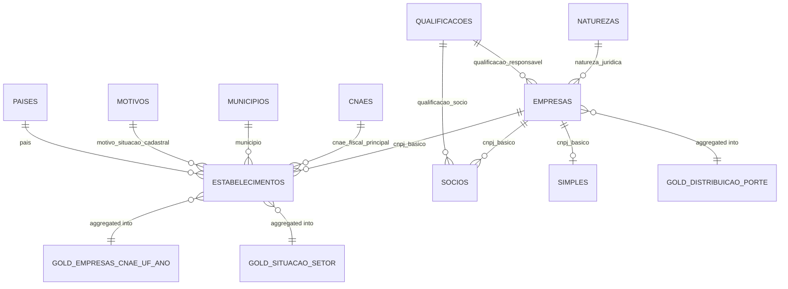

# 03 - Specification

> Phase 3 (ISO/IEC/IEEE 29148). Requirements with ID, verifiable acceptance criteria and data model. The requirements, priorities and acceptance criteria come from [02 - Analysis and prioritization](02-analysis-and-prioritization.md); this page restates each one as a user story with a Gherkin scenario, and describes the tables of each layer. How each scenario was executed is in [05 - Validation](05-validation.md).

## User stories (INVEST + Gherkin)

Roles are those of [01 - Vision and scope](01-vision-and-scope.md): the **operator** (Thales), the **data consumer** (analyst) and the **reviewer** (engineer). A `competencia` is a reference month `YYYY-MM`.

### RF-01 - Reproducible download (Must)

*As the operator, I want to download one reference month with one command, so that every run starts from the same verified files.*

```gherkin
Feature: Download of a Receita Federal release
  Scenario: RF-01 download a reference month with checksums
    Given the reference month "2026-09" is published on the Receita Federal share
    When I run "make download COMPETENCIA=2026-09"
    Then the unzipped files are in "data/raw/2026-09/"
    And "data/raw/2026-09/manifest.json" records the SHA-256 of every downloaded file
    And running the same command again downloads nothing
    And "--verify-only" checks every file against the manifest without network access
```

### RF-02 - Bronze ingestion (Must)

*As the reviewer, I want bronze to keep every source row with load metadata, so that any later number can be traced back to a file.*

```gherkin
Feature: Bronze ingestion
  Scenario: RF-02 every CSV row lands in bronze with metadata
    Given the files of "2026-09" in "data/raw/2026-09/"
    When I run "make bronze"
    Then each bronze Delta table has one row per source line
    And every row has "_ingest_ts", "_source_file" and "competencia" filled
    And a file whose field count differs from the documented layout fails the run
    And running "make bronze" again replaces the "2026-09" partition without duplicates
```

### RF-03 - Silver: typed, deduplicated, normalized (Must)

*As the data consumer, I want one typed current record per business key, so that I can count companies and establishments without double counting.*

```gherkin
Feature: Silver layer
  Scenario: RF-03 no duplicated business key and dates typed
    Given the bronze tables of "2026-09"
    When I run "make silver" and "make quality"
    Then no silver table has two rows with the same business key (RN-01 for establishments)
    And 100% of the non-empty valid dates are of type "date"
    And CNPJ, CNAE, money and string columns are normalized as in the data dictionary
    And a critical quality rule ("error") that fails stops the pipeline
```

### RF-04 - Incremental MERGE (Must)

*As the operator, I want a new month to update only what changed, so that monthly loads are cheap, idempotent and auditable.*

```gherkin
Feature: Incremental load
  Scenario: RF-04 a new month updates and inserts without duplicates
    Given silver loaded with "2026-09"
    When I load the next month "2026-10"
    Then the changed keys are updated and the new keys are inserted
    And the keys absent from "2026-10" are kept
    And no business key is duplicated

  Scenario: RF-04 re-running a month changes nothing
    Given silver loaded with "2026-09"
    When I load "2026-09" again
    Then 0 rows are inserted and 0 rows are updated
    And the table fingerprint is identical
```

### RF-05 - Gold tables (Must)

*As the data consumer, I want aggregated tables by CNAE/state/year, size and registration status, so that I can answer the business questions without scanning silver.*

```gherkin
Feature: Gold layer
  Scenario: RF-05 gold totals reconcile with silver
    Given the silver current state
    When I run "make gold" and "make reconcile"
    Then "gold_empresas_cnae_uf_ano", "gold_distribuicao_porte" and "gold_situacao_setor" exist
    And every additive gold total equals the count recomputed from silver (total, by UF, status, size and grain)
    And any mismatch exits with code 1
```

### RF-06 - Time travel (Should)

*As the reviewer, I want to query the previous version of a table, so that a past result can be reproduced.*

```gherkin
Feature: Time travel
  Scenario: RF-06 reproduce a query on version N-1
    Given silver "empresas" with a recorded aggregate after loading "2026-09"
    And the next month "2026-10" merged afterwards (version N)
    When I read the table with "versionAsOf N-1" and with "timestampAsOf" the first load
    Then both reproduce the recorded aggregate
```

### RF-07 - OPTIMIZE and VACUUM (Should)

*As the operator, I want to compact small files and remove old versions, so that reads stay fast and storage stays bounded.*

```gherkin
Feature: Table maintenance
  Scenario: RF-07 compaction reduces files and read time is measured
    Given bronze and silver tables with several small files per partition
    When I run "make optimize" and then "make vacuum"
    Then the number of files per partition drops
    And the read time before and after is recorded in "docs/benchmark.md"
    And the table fingerprints are unchanged
    And VACUUM refuses a retention below 168 hours
```

### RF-08 - Benchmark (Must)

*As the reviewer, I want a before/after benchmark with Spark UI evidence, so that the performance claim can be checked.*

```gherkin
Feature: Benchmark
  Scenario: RF-08 before x after with Spark UI evidence
    Given the pre-tuning commit and the current code
    When the "Benchmark" workflow runs both on the same runner and the same data
    Then "docs/benchmark.md" has a table of time, shuffle, spill and files per table
    And the silver and gold fingerprints of both sides are identical
    And the event logs and Spark UI screenshots are published as evidence
```

### RF-09 - Unit tests (Must)

*As the reviewer, I want fast tests on small DataFrames, so that every change is checked without the real dataset.*

```gherkin
Feature: Unit tests
  Scenario: RF-09 tests run without the full dataset
    Given a pull request
    When CI runs "make test"
    Then pytest runs on in-memory DataFrames and the synthetic release in "tests/fixtures"
    And no test reads the real Receita Federal files
    And the run fails below 80% line coverage
```

### RF-10 - Partner record linkage (Could)

*As the data consumer, I want candidate pairs of partners with similar names, so that I can study shared ownership.*

```gherkin
Feature: Partner record linkage
  Scenario: RF-10 candidate pairs with a score
    Given silver "socios"
    When I run the linkage job
    Then candidate pairs are generated with a similarity score
    And a sample of pairs is reviewed manually
```

Implemented as a technical exercise (task 7.4): blocking by normalized first + last name token and the masked CPF digits, Jaro-Winkler score, bands `match` ≥ 0.92 and `review` 0.85–0.92, aggregates-only report and a local, git-ignored review sample ([linkage](linkage.md), [ADR 014](adr/014-partner-record-linkage-and-privacy.md)). Proven on synthetic partners; the real-data review is pending.

### Non-functional requirements, rule and constraint

```gherkin
Feature: Quality attributes
  Scenario: RNF-01 main job at least 30% faster after tuning
    Given the main job (silver MERGE + gold) before and after tuning on the same runner
    When both are measured 3 times with the same data
    Then the median time drops by at least 30% with identical results

  Scenario: RNF-02 portable environment
    Given Docker and Docker Compose
    When I run "make up" and "make smoke"
    Then MinIO and the Spark master and worker are healthy
    And a Delta table is written to and read from MinIO through the cluster

  Scenario: RNF-03 runs within limited memory
    Given "SPARK_SAMPLE_FRACTION" set to a number in (0, 1]
    When I run "make bronze"
    Then the large tables are sampled deterministically (fixed seed)
    And with "1.0" the files are loaded whole

  Scenario: RNF-04 pure, testable transformations
    Given a transformation in normalize, bronze, silver or gold
    Then it is a function of DataFrames or Columns without I/O, tested in isolation

  Scenario: RNF-05 pinned versions
    Given "pyproject.toml", "cnpj_lakehouse/versions.py" and the Spark image
    Then Spark, Delta and Python versions are pinned and agree with each other

  Scenario: RN-01 establishment business key
    Given two establishment rows with the same base CNPJ, branch order and check digits
    Then silver keeps exactly one of them, chosen by the documented ordering

  Scenario: RST-01 no re-identification and no raw data in the repository
    Given any report, notebook, job summary, artifact or fixture of the project
    Then it holds aggregates, counts or synthetic rows only
    And the synthetic CNPJ bases of the fixtures are absent from the real registry
```

## Data model

Column-level detail (source layout, types, normalization, domains, gold columns) is in the [data dictionary](data-dictionary.md), which mirrors `cnpj_lakehouse/schemas.py`. All tables are Delta tables in the MinIO bucket (`s3a://<bucket>/<layer>/<table>/`, [ADR 001](adr/001-storage-format-csv-parquet-delta.md)).

### Layers, grain, keys and partitioning

| Layer | Table | Grain (one row per) | Key | Partitioning | Write | ADR |
|---|---|---|---|---|---|---|
| raw | `data/raw/<competencia>/*.csv` + `manifest.json` | source line | — | folder per month | download, SHA-256 manifest | [007](adr/007-cnpj-source-nextcloud-webdav.md) |
| bronze | `empresas`, `estabelecimentos`, `socios`, `simples`, `cnaes`, `motivos`, `municipios`, `naturezas`, `paises`, `qualificacoes` | source line of a month | none (as received) | `competencia` | overwrite with `replaceWhere` on the month | [002](adr/002-partitioning-by-month-and-state.md), [008](adr/008-bronze-all-strings-typed-in-silver.md) |
| silver | `estabelecimentos` | establishment | `cnpj_basico` + `cnpj_ordem` + `cnpj_dv` (RN-01) | none | Delta `MERGE` on the key (current state) | [009](adr/009-alphanumeric-cnpj-and-invalid-values.md), [010](adr/010-invalid-and-all-zero-cnpj-in-silver.md), [011](adr/011-silver-current-state-merge.md) |
| silver | `empresas` | company | `cnpj_basico` | none | `MERGE` | [011](adr/011-silver-current-state-merge.md) |
| silver | `simples` | company | `cnpj_basico` | none | `MERGE` | [011](adr/011-silver-current-state-merge.md) |
| silver | `socios` | partner of a company | `cnpj_basico` + `identificador_socio` + `cpf_cnpj_socio` + `nome_socio_razao_social` (natural key, null-safe) | none | `MERGE` | [011](adr/011-silver-current-state-merge.md) |
| silver | lookups (`cnaes`, `motivos`, `municipios`, `naturezas`, `paises`, `qualificacoes`) | code | `codigo` | none | `MERGE` | [011](adr/011-silver-current-state-merge.md) |
| gold | `gold_empresas_cnae_uf_ano` | (`cnae_fiscal_principal`, `uf`, `ano_inicio_atividade`) | the grain | none | whole-table overwrite | [012](adr/012-gold-aggregations-and-counting-rules.md) |
| gold | `gold_distribuicao_porte` | `porte_empresa` | the grain | none | whole-table overwrite | [012](adr/012-gold-aggregations-and-counting-rules.md) |
| gold | `gold_situacao_setor` | (`situacao_cadastral`, `cnae_divisao`) | the grain | none | whole-table overwrite | [012](adr/012-gold-aggregations-and-counting-rules.md) |

Columns added by the pipeline:

| Layer | Column | Type | Description | Rule |
|---|---|---|---|---|
| bronze | `competencia` | string | Reference month `YYYY-MM` of the release | Partition column; in silver, the month of the key's last change (ADR 011) |
| bronze | `_ingest_ts` | timestamp | Time of the bronze load | Kept in silver from the last change |
| bronze | `_source_file` | string | Source file name | Kept in silver from the last change |
| silver | `_row_hash` | string | SHA-256 of the JSON of the business columns (metadata excluded) | `MERGE` updates only when it changes |
| silver | `cnpj` | string | 14-character CNPJ (base + order + DV) of `estabelecimentos` | Alphanumeric supported (ADR 009) |
| silver | `cnpj_valido` | boolean | Check digits match and the CNPJ is not all zeros | Kept and counted by default (ADR 010) |

Every bronze column is a nullable string (ADR 008); silver applies the documented types (`date`, `decimal`, arrays) and normalization.

### Entity relationships



The relationships are logical (no foreign keys in Delta); the quality checks report lookup references that do not resolve (`cnpj_lakehouse/quality.py`). Establishments whose company is not in silver `empresas` are counted and reported by gold (`without_company`, ADR 012).
