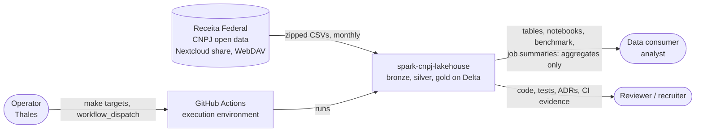
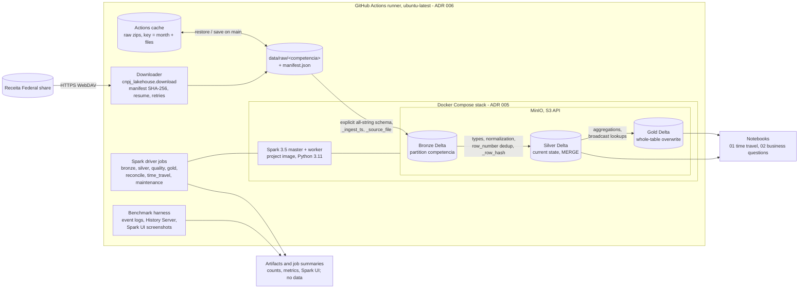

# 04 - Architecture (simplified C4)

Two C4 levels are drawn (context and containers); the components are listed in a table, since each one is a Python module with its own tests. Decisions are linked to their ADRs.

## Context

The lakehouse turns the monthly CNPJ open data of the Receita Federal into Delta tables and documented, measured results. It runs on GitHub Actions ([ADR 006](adr/006-ci-as-execution-environment.md)) or on any machine with Docker; there is no managed cloud service.

- **Receita Federal share** ([ADR 007](adr/007-cnpj-source-nextcloud-webdav.md)): one full snapshot per month (`competencia`), Latin-1 `;`-separated CSVs in zips; the URL is configurable because it moved before (R-04).
- **Constraint RST-01 (LGPD):** nothing leaves the pipeline except aggregates, counts and metadata; raw data is never committed.

## Containers

| Container | Technology | Responsibility | ADR |
|---|---|---|---|
| Downloader | Python (`requests`), `make download` | Download and unzip one month; `manifest.json` with size and SHA-256 per zip; resume with `Range`, retries; `--verify-only` checks offline | [007](adr/007-cnpj-source-nextcloud-webdav.md) |
| Raw files | Local disk + Actions cache | PR runs restore the zips from the cache and verify them against the manifest; only pushes to `main` save the cache | [006](adr/006-ci-as-execution-environment.md) |
| Spark cluster | Docker Compose: project Spark image (Spark 3.5, Python 3.11), 1 master + 1 worker | Distributed execution of every job; driver runs in a container next to the cluster | [005](adr/005-docker-environment-images.md) |
| Object storage | MinIO (`pgsty/minio`), `s3a://` | Holds the bronze, silver and gold Delta tables | [001](adr/001-storage-format-csv-parquet-delta.md), [005](adr/005-docker-environment-images.md) |
| Bronze | Delta, partitioned by `competencia`, `replaceWhere` | Source as received, all strings, load metadata, layout check | [002](adr/002-partitioning-by-month-and-state.md), [008](adr/008-bronze-all-strings-typed-in-silver.md) |
| Silver | Delta, not partitioned, `MERGE` by business key | Typed and normalized current state per key; quality checks | [009](adr/009-alphanumeric-cnpj-and-invalid-values.md), [010](adr/010-invalid-and-all-zero-cnpj-in-silver.md), [011](adr/011-silver-current-state-merge.md) |
| Gold | Delta, whole-table overwrite | Three aggregated tables, sum checks and reconciliation with silver | [003](adr/003-broadcast-join-for-lookup-tables.md), [012](adr/012-gold-aggregations-and-counting-rules.md) |
| Maintenance | `OPTIMIZE` (128 MiB), `VACUUM` (840 h) | File compaction and bounded history | [004](adr/004-target-file-size.md), [013](adr/013-table-maintenance-and-vacuum-retention.md) |
| Benchmark | `scripts/benchmark.py`, Spark event logs, History Server, headless Chromium | Before × after on one runner with identical fingerprints | [006](adr/006-ci-as-execution-environment.md) |
| Notebooks | Jupyter, executed by workflows | Time travel demo and business questions on gold (aggregates only) | [012](adr/012-gold-aggregations-and-counting-rules.md) |

### Execution environment (workflows)

| Workflow | Trigger | What it runs |
|---|---|---|
| `CI` (`ci.yml`) | push to `main`, pull requests | `lint-test` (ruff, black, mypy strict, `make test` with ≥ 80% coverage); `smoke` (`make up` + Delta write/read on MinIO); `bronze` (cached `lookups` + `Empresas1` of 2026-09 through bronze, silver, re-run, synthetic next month, time travel, quality, gold, reconcile). The three jobs are required checks of `main`. |
| `Download` (`download.yml`) | PRs that touch the downloader, manual; `schedule` day 15 | `download`: live download + idempotent re-run. `monthly-check`: latest published month, `lookups Empresas1 Estabelecimentos1` unsampled, full pipeline, opens or updates an issue on failure |
| `Benchmark` (`benchmark.yml`) | manual | Main job before (`compare_ref`) and after on the same runner, median of 3, Spark UI evidence, format comparison, `OPTIMIZE`/`VACUUM` |
| `Gold analysis` (`gold-analysis.yml`) | manual | Real subset with `Estabelecimentos`, gold roll-ups, executes notebook 02 |
| `Fixture privacy` (`fixture-privacy.yml`) | PRs touching fixtures, manual, monthly | Checks that the synthetic CNPJ bases are absent from the real registry (RST-01) |

## Components

| Component (`src/cnpj_lakehouse/`) | Role | Main tests |
|---|---|---|
| `download.py` | RF-01 download, manifest, verify | `test_download.py`, `test_latest_competencia.py` |
| `schemas.py` | Layout and target types per table (data dictionary) | `test_schemas.py` |
| `bronze.py` | RF-02 read, layout check, metadata, sampling (RNF-03), write | `test_bronze.py`, `test_bronze_counts.py` |
| `normalize.py` | Pure `Column -> Column` normalization (RNF-04) | `test_normalize.py` |
| `silver.py` | RF-03 dedup and RF-04 `MERGE` | `test_silver.py`, `test_silver_dedup.py`, `test_silver_merge.py`, `test_silver_idempotency.py` |
| `quality.py` | RF-03 declarative quality rules and report | `test_quality.py` |
| `fingerprint.py` | Order-independent table digest (idempotency, benchmark) | `test_fingerprint.py` |
| `gold.py`, `reconcile.py` | RF-05 aggregations and silver × gold reconciliation | `test_gold.py`, `test_gold_delta.py`, `test_reconcile.py` |
| `time_travel.py` | RF-06 history and `versionAsOf` / `timestampAsOf` | `test_time_travel.py` |
| `maintenance.py` | RF-07 `OPTIMIZE` / `VACUUM` | `test_maintenance.py` |
| `benchmark.py` | RF-08 event-log parsing and metrics | `test_benchmark.py` |
| `spark.py`, `versions.py` | Session factory, tuning conf, pinned versions (RNF-02, RNF-05) | `test_spark.py`, `test_versions.py`, `test_smoke.py` |
| `pipeline.py` | Placeholder for a single-command orchestration (`make run`); today the steps run as separate `make` targets | — |

## Diagram

The diagrams above are Mermaid and render on GitHub. The README keeps a one-picture overview of the layers; the benchmark screenshots are in [`docs/img/benchmark`](img/benchmark).
