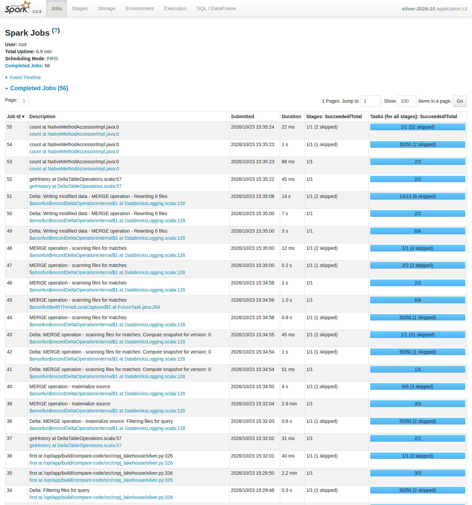
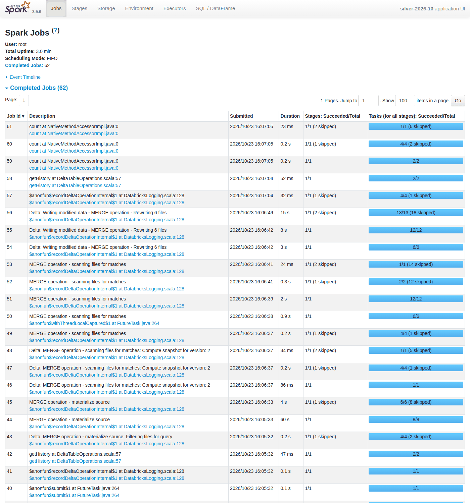
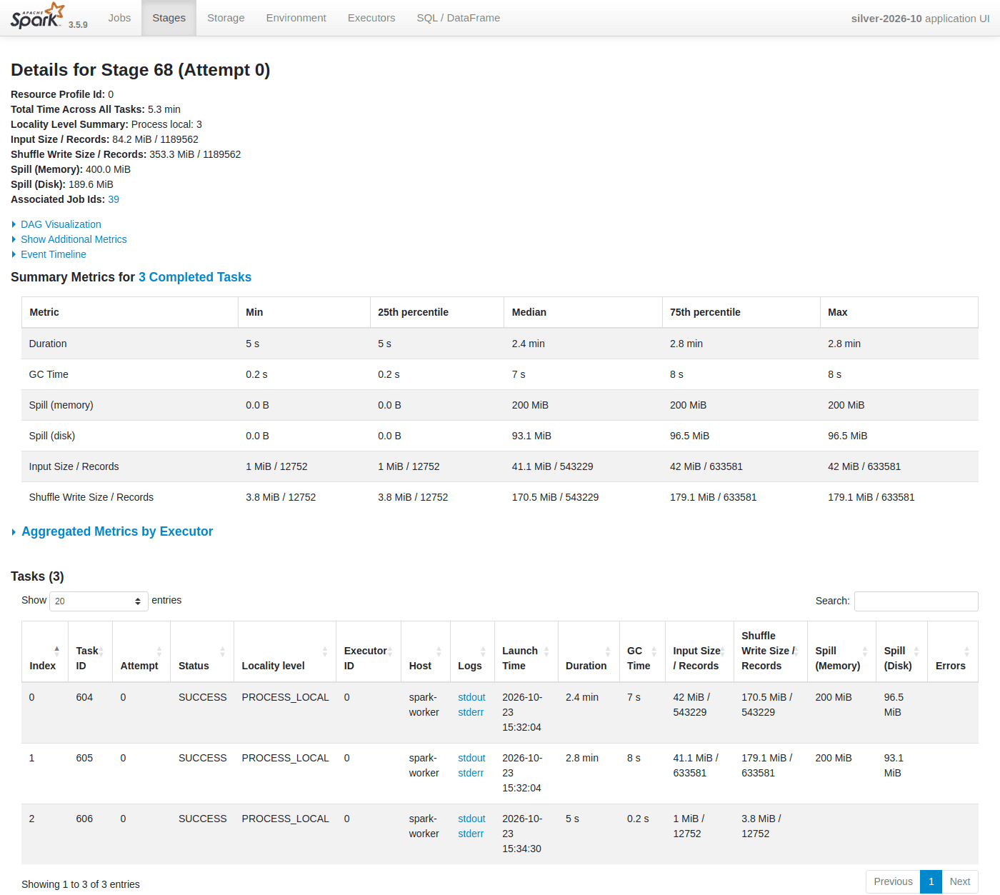
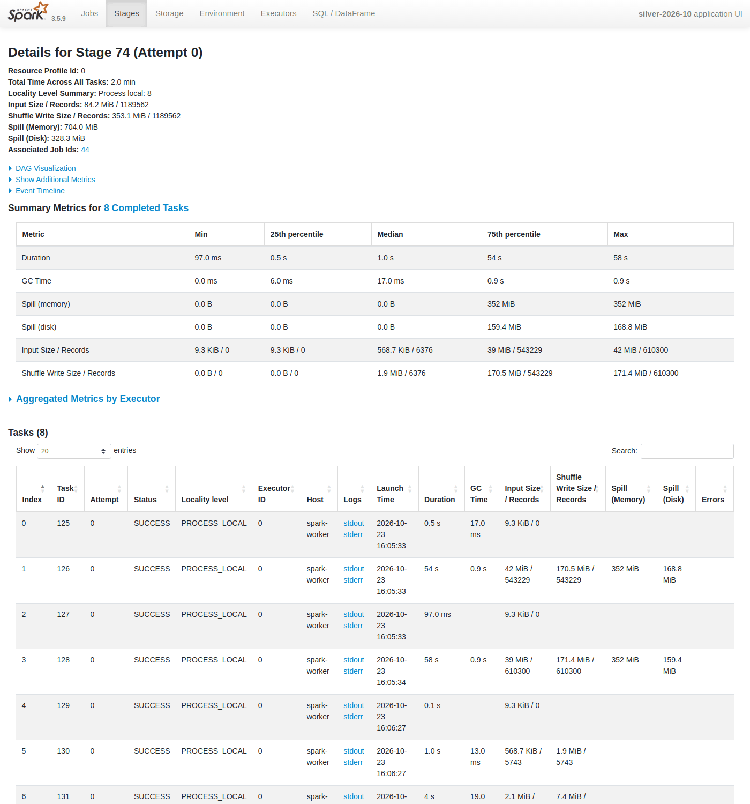
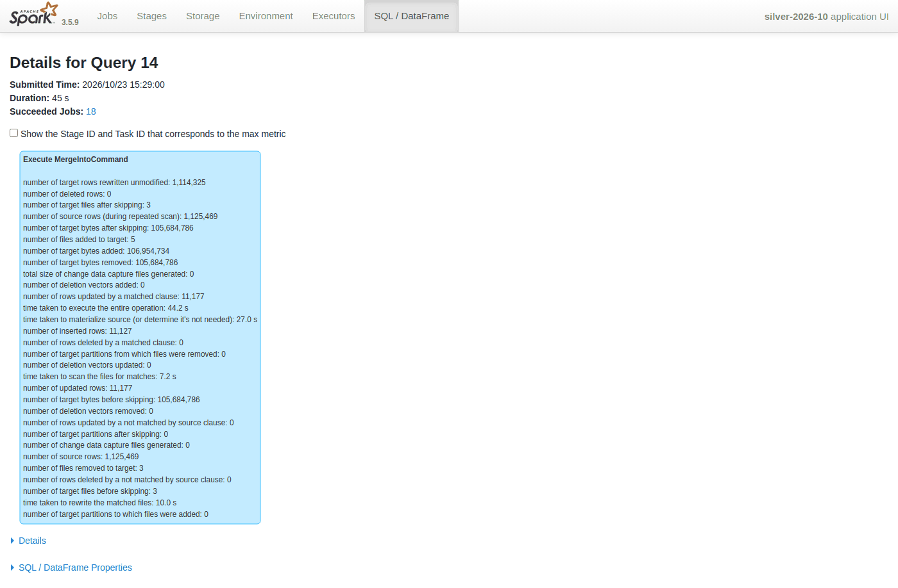
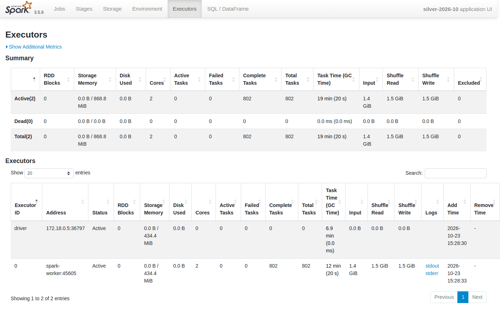
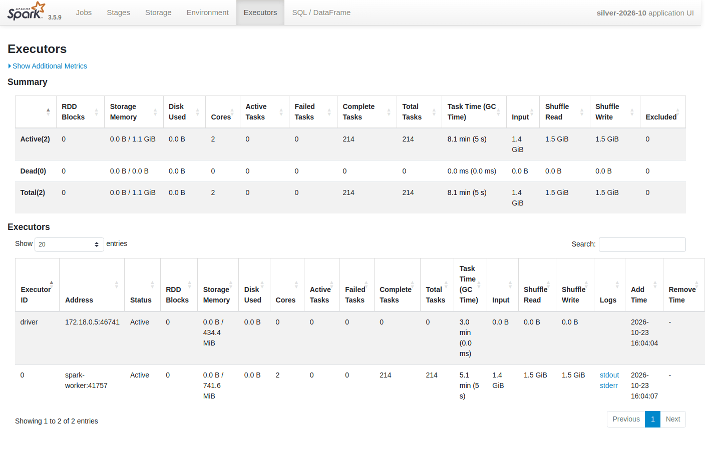

# Benchmark (RF-08, RNF-01)

Baseline of the main job before any tuning (task 6.1). The tuning itself is task 6.2 and the before × after comparison is task 6.4. Runs execute on GitHub Actions runners ([ADR 006](adr/006-ci-as-execution-environment.md)): every measurement is repeated 3 times, the median is reported and the runner specification is recorded.

> **Status: measured.** Baseline from the `Benchmark` run [39447843930](https://github.com/thalesreiser/spark-cnpj-lakehouse/actions/runs/39447843930) on `main` (2026-10-20, Spark 3.5.3, median of 3 repetitions). The full sheet, the event logs and the Spark UI pages are in its `benchmark-2026-09` artifact.

> **Final result (task 6.4):** on one runner and one CPU, the main job went from **481.9 s to 240.6 s (−50.1%)** with identical silver and gold tables — see [Before × after (task 6.4)](#before--after-task-64) right below. The sections after it (baseline 6.1, tuning 6.2, `OPTIMIZE`/`VACUUM` 6.3) are kept as the history of the work.

## Before × after (task 6.4)

> **Status: measured.** `Benchmark` run [39975706499](https://github.com/thalesreiser/spark-cnpj-lakehouse/actions/runs/39975706499) on branch `feat/p2-6.4` (2026-10-23, Spark 3.5.9, Delta Lake 3.3.3, runner CPU **AMD EPYC 7763**, 4 vCPU). The full sheet is `compare/compare.md` / `.json` in its `benchmark-2026-09` artifact, next to both sets of event logs and Spark UI pages.

**Why a new run.** The 6.1/6.2/6.3 numbers came from different jobs, and GitHub assigned two CPU models (EPYC 7763 for the baselines and 6.3, EPYC 9V74 for the 6.2 runs), so "459.7 s → 169.8 s" mixed the tuning with a faster CPU. This run measures **both codes in the same job, on the same runner, with the same data**:

- **Before** = commit [`e1dcb45`](https://github.com/thalesreiser/spark-cnpj-lakehouse/commit/e1dcb4535a8b9126e2288bf95f140c1c30a12c6a), the last commit before the 6.2 tuning (Spark 3.5.9, `spark.executor.memory=1g`, AQE on, everything else at the defaults). The workflow checks it out into `build/compare-code` and `scripts/benchmark.py run --code build/compare-code --step-env SPARK_EXECUTOR_MEMORY=1g --prefix benchmark-baseline` runs the measured steps with that checkout's `src/` on `PYTHONPATH` (the Spark image is the same: the workflow fails if `pyproject.toml`, `infra/spark` or `versions.py` differ). The event logs confirm it: the `first()` stage is `at /opt/app/build/compare-code/src/cnpj_lakehouse/silver.py:326` and the properties are the pre-tuning ones.
- **After** = the current code (6.2 tuning; the main job is unchanged by 6.3), then the 6.3 maintenance step (`OPTIMIZE` + Z-order trial + `VACUUM`) on its tables.
- Same inputs for both: release `2026-09`, files `lookups Empresas1 Estabelecimentos1`, bronze sample 0.25 (loaded once, read by both), synthetic `2026-10`, median of 3 repetitions each, same cluster (1 worker, 2 cores, 2 GB). Before ran first, then after.
- **Same results asserted:** `scripts/benchmark.py compare` fingerprints (rows + order-independent SHA-256, `cnpj_lakehouse.fingerprint`) the 8 silver tables and the 3 gold tables of the median run of each side and fails the job if any differs. All 11 are **identical** (silver `empresas` 1,136,629 rows, `estabelecimentos` 1,201,534; gold `gold_empresas_cnae_uf_ano` 205,019).

### Same-runner table

| Metric (median of 3) | Before (`e1dcb45`) | After (6.2 + 6.3) | Change |
|---|---:|---:|---:|
| **Main job (silver `MERGE` + gold), wall** | **481.9 s** | **240.6 s** | **−50.1%** |
| silver `MERGE`, wall | 417.2 s | 184.7 s | −55.7% |
| gold, wall | 64.7 s | 53.7 s | −17.0% |
| Initial silver load (setup, 1 run), wall | 373.6 s | 166.3 s | −55.5% |
| Main job tasks (silver `MERGE` + gold) | 1,980 (906 + 1,074) | 368 (214 + 154) | −81.4% |
| Main job stages | 133 | 133 | = |
| Shuffle read / write | 1.6 / 1.6 GiB | 1.6 / 1.6 GiB | = |
| Spill (memory) | 900.0 MiB | 704.0 MiB | −21.8% |
| Spill (disk) | 397.5 MiB | 328.3 MiB | −17.4% |
| Executor run time / GC | 767.7 / 21.3 s | 344.1 / 6.0 s | −55.2% / −71.8% |
| Max task skew (max / median) | 17.27x | 69.62x | see diagnosis |
| Longest `MERGE` stage (source materialization: typing, row hash, window) | 165.8 s, 3 tasks | 59.6 s, 8 tasks | −64.1% |
| Quality-counts `first()` of `estabelecimentos` | 131.6 s, 3 tasks | 22.2 s, 8 tasks | −83.1% |
| Main job per repetition | 481.9 / 485.7 / 463.0 s | 232.5 / 240.6 / 241.4 s | spread < 5% |

Files per table (live files; the main job writes the same files with both codes, `OPTIMIZE` is the 6.3 step run on the after tables):

| Table | Before (after the main job) | After the main job | After `OPTIMIZE` (+ Z-order trial) |
|---|---|---|---|
| bronze/empresas (shared input) | 15 files, 3–12 per partition | same | 2 files, **1 per partition** |
| bronze/estabelecimentos (shared input) | 17 files, 8–9 per partition | same | 2 files, **1 per partition** |
| silver/empresas | 5 files (avg 20.4 MiB) | 5 files (avg 20.4 MiB) | **1 file** |
| silver/estabelecimentos | 13 files (avg 12.9 MiB) | 13 files (avg 12.9 MiB) | 2 files after compaction, 1 after the Z-order trial |
| gold (3 tables) | 2 / 1 / 1 files | 2 / 1 / 1 files | not compacted (KB tables) |

Read workload on silver (the five 6.3 queries, median of 3, measured in one Spark session on both silver copies: before = the table as the pre-tuning code wrote it, after = the current table after `OPTIMIZE`):

| Query | Before | After | Change |
|---|---:|---:|---:|
| establishments by UF and status | 0.66 s | 0.36 s | −45.5% |
| active companies in SP (filter `uf`) | 1.08 s | 0.49 s | −54.6% |
| establishments of one CNAE (filter) | 0.59 s | 0.28 s | −52.5% |
| capital by company size | 0.62 s | 0.55 s | −11.3% |
| active establishments by size (join) | 1.32 s | 0.89 s | −32.6% |
| **Total** | **4.27 s** | **2.57 s** | **−39.8%** |

### Spark UI (History Server over the event logs, median repetition of the silver `MERGE`)

Rendered headlessly in the same job (`scripts/spark_ui_screenshots.py`: a Spark History Server in the `spark-client` image, Chromium through Playwright, palette PNGs). The Spark UI shows plans, metrics, timestamps, container addresses and code paths, never rows; each image was reviewed before committing.

**Jobs list** — before: the `first at …/compare-code/…/silver.py:326` job takes 2.2 min and `MERGE operation - materialize source` 2.8 min, each with 3 tasks; Delta snapshot jobs run 50 tasks each. After: the same jobs are seconds to under a minute, and the snapshot jobs run 4 tasks.

**Longest stage of the `MERGE`** (source materialization of `estabelecimentos`) — before: stage 68, 3 tasks, two of them 2.4–2.8 min, 5.3 min of task time, 400 MiB / 190 MiB spill. After: stage 74, 8 tasks (16 MB input splits), the two large ones 54–58 s, 2.0 min of task time; same 353 MiB shuffle write; spill 704 / 328 MiB (the window sort of the two ~40 MB files of the synthetic month).

**SQL page of the longest query** (`Execute MergeIntoCommand` of silver `empresas`): identical operation metrics (11,177 rows updated, 11,127 inserted, 1,114,325 rewritten unmodified, 3 files removed, 5 added) — the same `MERGE` result — in 44.2 s before and 34.8 s after (materialize source 27.0 → 19.5 s).

**Executors** — one executor with 2 cores in both; before 906 tasks, 1 GB executor memory; after 214 tasks, 1.5 GB (741.6 MiB of storage memory), 1.5 GiB shuffle read and write in both.

### Diagnosis (R-P2-02)

- **Target met on the same hardware: −50.1% for the main job**, above the 30% of RNF-01, with identical tables. The 6.2 figure of −63.1% (459.7 → 169.8 s) overstated the gain: it compared an EPYC 7763 baseline with an EPYC 9V74 tuned run. On the 7763, the tuned code takes 240.6 s here and 239.4 s in the 6.3 run (same CPU, a different job: within 1%), and the pre-tuning code 481.9 s here against 459.7 s and 460.6 s in the 6.1/6.2 baselines (+5%, runner noise between jobs). Roughly, the CPU explains a 1.4x factor (240 s vs 170 s for the same code) and the tuning a 2x factor.
- **What moved the needle:** the CNPJ check digits computed over a helper root column. It removed the 12-fold re-evaluation of the key normalizers and the codegen fallback, and is most of the drop of the two heaviest stages (`first()` 131.6 → 22.2 s, source materialization 165.8 → 59.6 s) and of the executor time (−55%). The 16 MB input splits of silver spread those stages over 8 tasks instead of 3, and the initial load improved as much as the `MERGE` (−55.5%). Delta snapshot partitions 50 → 4 turned the log-replay jobs from 50 tasks into 4: most of the 1,612 fewer tasks (−81%) and of the gold gain. The 1.5 GB executor memory cut GC by 72% and spill by about a fifth. For reads, `OPTIMIZE` (6.3) took the silver files from 5/13 to 1–2 and the read workload from 4.27 to 2.57 s (−40%).
- **What did not move:** shuffle volume (1.6 GiB, the `MERGE` window and join are the same plan), the number of stages (133) and the files written by the main job (the file count follows the input, by design, [ADR 004](adr/004-target-file-size.md)). Gold gained only 17% on this CPU (against 36% on the 9V74): it is ~50 s of short Delta log and JVM work, where task count was not the bottleneck. The Z-order trial gave no data skipping at the sample size (one file; not adopted, [ADR 013](adr/013-table-maintenance-and-vacuum-retention.md)).
- **Remaining bottlenecks:** the source materialization of the `estabelecimentos` `MERGE` is still 60 s, dominated by two tasks of ~55 s that read the two large files of the synthetic month (one row group each) and spill in the window sort — the 69.6x skew ratio is those two tasks against six tiny ones, not idle cores (both run in parallel on the 2 cores). The rest of the `MERGE` is many short stages (Delta snapshots, file scans, commits) and 2–3 s of JVM start per step. CPU of the typing (regular expressions, SHA-256 row hash) is the floor on 2 executor cores.
- **What would come next:** write the synthetic next month (and the bronze months) in files of several row groups, or repartition the `MERGE` source by the business key, so the window sort runs as more, smaller tasks with no spill; restrict the `MERGE` target scan with a partition or a file-level predicate once silver is large; reuse one Spark application for silver and gold (no second JVM and Delta snapshot rebuild); run `OPTIMIZE` monthly after the `MERGE` (6.3). At full volume (not sampled) the same changes should hold, but the numbers here are for the 25% sample of two of the ten files.
- **Limits of this measurement:** one runner and 3 repetitions per side; before always ran first (no interleaving), so slow drift of the runner during the job would favour one side — the per-repetition spread is under 5% on both sides, far below the 50% difference. Reads are sub-second and noisier.

## Main job and reference volume

- **Main job: the monthly incremental load, silver `MERGE` + gold.** It runs every month in production and holds the widest operations of the pipeline: the deduplication window, the row hash and the `MERGE` by business key in silver ([ADR 011](adr/011-silver-current-state-merge.md)), then the joins and aggregations of gold ([ADR 012](adr/012-gold-aggregations-and-counting-rules.md)). Bronze is a plain CSV → Delta copy and is left out.
- **Volume:** release `2026-09`, files `lookups` (whole), `Empresas1` and `Estabelecimentos1` (~440 MB zipped), with a deterministic 25% sample of the two large tables in bronze (`SPARK_SAMPLE_FRACTION=0.25`, fixed seed, RNF-03). The next month (`2026-10`) is synthetic and derived from the same bronze by `scripts/silver_next_month.py` (about 1% of the keys updated, 1% inserted, 1% absent), so the `MERGE` has real inserts and updates. `Estabelecimentos1` is included because without it gold builds only the size table and the job has no join worth measuring.
- **Why the sample:** a trial run with every row (≈ 4.5 M companies + 4.8 M establishments) took about 25 min for the initial silver load and 27 min for the `MERGE` on a 2-CPU runner, and the shuffle files filled the 14 GB disk during the second repetition. The sample keeps the same plan and the same operations at a size that fits 3 repetitions in the runner and in the Actions minutes. The fraction is a workflow input (`sample_fraction`), so a full-volume run stays possible.

## Environment

| Item | Value |
|---|---|
| Runner | GitHub-hosted `ubuntu-latest` (image `ubuntu24 20261018.339.1`). The repository is public since 2026-10-20, so the runner has **4 vCPU and 15.6 GiB RAM** (the trial runs below were on the 2 vCPU / 8 GB private-repository runner); recorded in the job summary and in `benchmark.json` |
| Stack | Docker Compose of the project ([ADR 005](adr/005-docker-environment-images.md)): 1 Spark master, 1 worker (2 cores, 2 GB), driver in `spark-client`, MinIO (s3a) |
| Versions | **Baseline measured on Spark 3.5.3**, Delta Lake 3.2.1, Python 3.11, Java 17 (`cnpj_lakehouse/versions.py`). The project moved to Spark 3.5.8 and then 3.5.9 with Delta Lake 3.3.3 afterwards (#26 security fix, dependency updates; same data: the silver fingerprints of CI are identical on every version); task 6.2 measures on 3.5.9 / Delta 3.3.3, so a small part of any difference may come from the patch releases |
| Key configs | `spark.executor.memory=1g`, `spark.sql.adaptive.enabled=true`, everything else at the Spark defaults (e.g. `spark.sql.shuffle.partitions=200`, `spark.sql.autoBroadcastJoinThreshold=10MB`); the properties actually set are read from the event log |

## Method

1. `Benchmark` workflow (`.github/workflows/benchmark.yml`, `workflow_dispatch` only): frees disk, downloads the files, brings up the stack, loads bronze (`2026-09`) and the synthetic next month (`2026-10`).
2. `scripts/benchmark.py run` (also `make benchmark`), inside the `spark-client` container. Each step is its own Spark application with **event logs enabled** through `SPARK_EVENT_LOG_DIR` (`cnpj_lakehouse/spark.py`), so the pipeline code is unchanged:
   - setup, once: `cnpj_lakehouse.silver` for `2026-09` creates the silver tables (reported, not repeated);
   - main job, 3 times: `cnpj_lakehouse.silver` for `2026-10` (`MERGE` of `empresas` and `estabelecimentos`), then `cnpj_lakehouse.gold`. Before repetitions 2 and 3 the merged tables are restored to version 0 (Delta `RESTORE`) and the files of the undone `MERGE` are vacuumed, so every repetition merges the same month into the same table.
3. `cnpj_lakehouse.benchmark` parses each event log (no `SparkListener` and no live UI needed): wall time, jobs, stages, tasks, shuffle read/write bytes, memory and disk spill, input/output bytes, executor and GC time, task-duration skew (max / median) per stage and the longest stages. It reports the median of the 3 repetitions per step and for the main job (the sum of its two steps per repetition).
4. Files: `DESCRIBE DETAIL` (`numFiles`, `sizeInBytes`) for every bronze, silver and gold table, and live files per partition value for the partitioned tables (bronze by `competencia`).
5. **Spark UI evidence:** `scripts/benchmark.py ui` starts a Spark History Server over the event logs and saves, for the median repetition, the REST API JSON (jobs, stages, executors, task-duration quantiles of the 3 longest stages) and the server-rendered jobs, stages and SQL pages. The workflow uploads `benchmark.json`, `benchmark.md`, the event logs and these pages as the `benchmark-<competencia>` artifact (metadata only, never rows, RST-01). To browse the full UI, download the artifact and run a History Server locally with `spark.history.fs.logDirectory` pointing at `eventlogs/`.

## Baseline

Median of 3 repetitions (median repetition: #3). The main job is the sum of its two steps per repetition; the setup (initial silver load of `2026-09`, run once) is shown for reference.

| Metric (median of 3) | silver `MERGE` | gold | Main job | Setup: initial silver (1 run) |
|---|---:|---:|---:|---:|
| Wall time | 395.1 s | 63.6 s | **459.7 s** | 372.6 s |
| Jobs / stages / tasks | 66 / 66 / 817 | 85 / 82 / 1,087 | 151 / 148 / 1,904 | 152 / 152 / 2,139 |
| Shuffle read / write | 1.5 / 1.5 GiB | 145.7 / 145.7 MiB | 1.6 / 1.6 GiB | 486.6 / 486.6 MiB |
| Spill (memory / disk) | 840.0 / 364.0 MiB | 0 / 0 | 840.0 / 364.0 MiB | 400.0 / 189.6 MiB |
| Input / output | 1.4 GiB / 269.1 MiB | 93.7 / 1.3 MiB | 1.4 GiB / 270.4 MiB | 127.7 / 264.3 MiB |
| Executor run time / GC | 662.0 / 18.6 s | 62.4 / 1.3 s | 724.4 / 19.9 s | 619.5 / 23.8 s |
| Max task skew (max / median) | 15.32x | 18.76x | 18.76x | 14.36x |

Main job per repetition: 454.2 s, 461.1 s, 459.7 s (spread under 2%); shuffle write 1.6 GiB in all three; disk spill 184.7, 364.0 and 364.0 MiB.

| Table | Files | Size | Avg file size | Files per partition |
|---|---:|---:|---:|---|
| bronze/empresas | 15 | 58.7 MiB | 3.9 MiB | 3–12 (2 partitions) |
| bronze/estabelecimentos | 17 | 165.5 MiB | 9.7 MiB | 8–9 (2 partitions) |
| silver/empresas | 5 | 102.0 MiB | 20.4 MiB | 5 (not partitioned) |
| silver/estabelecimentos | 13 | 167.1 MiB | 12.9 MiB | 13 (not partitioned) |
| gold/gold_empresas_cnae_uf_ano | 2 | 1.3 MiB | 679.7 KiB | 2 |
| gold/gold_distribuicao_porte | 1 | 2.2 KiB | 2.2 KiB | 1 |
| gold/gold_situacao_setor | 1 | 8.1 KiB | 8.1 KiB | 1 |

Lookup tables (bronze and silver `cnaes`, `motivos`, `municipios`, `naturezas`, `paises`, `qualificacoes`) are one file each, 3 KiB to 432 KiB.

## Observations

- **The `MERGE` dominates: 86% of the main job (395 of 460 s).** Its two longest stages are a Delta write stage of 164.5 s with only **3 tasks**, which writes 353 MiB of shuffle and spills 185 MiB to disk, and the `first()` at `silver.py:326` (110.2 s, 3 tasks), an action that forces a full pass over the month before the write. Together they are 70% of the `MERGE` (275 of 395 s).
- **Too few tasks for the heavy stages, too many for the light ones.** The heaviest silver stages run with 2–3 tasks on a 4-core runner (few large input splits; the worker has 2 cores), so most of the CPU is idle while they spill. Gold does the opposite: 1,087 tasks for 64 s of work (default `spark.sql.shuffle.partitions=200` on tiny aggregations), which is where the 18.8x skew ratio comes from — stages of a few seconds where one task is slower, not real data skew.
- **Spill in the `MERGE` write** (840 MiB memory, 364 MiB disk) with `spark.executor.memory=1g`: the executor memory and the number of partitions of the write are the first levers.
- **Code generation** is disabled for the row-hash plans ("Code grows beyond 64 KB" in the trial logs), so those stages run interpreted.
- **Files:** silver is written as 5 and 13 files of 13–20 MiB, below the usual 128 MiB–1 GiB target, and bronze `empresas` has a partition with 12 files of a few MiB (small files, task 6.3 `OPTIMIZE`). Gold tables are tiny, so their file count does not matter.
- Candidate changes for task 6.2: drop or cache the `first()` pass, repartition the `MERGE` source to match the cores, enable AQE coalescing with a lower initial `shuffle.partitions` for gold, raise the executor memory within the worker's 2 GB, and `OPTIMIZE` bronze (6.3).

## After tuning (task 6.2)

> **Status: measured.** `Benchmark` run [39782875127](https://github.com/thalesreiser/spark-cnpj-lakehouse/actions/runs/39782875127) on branch `feat/p2-6.2` (2026-10-22, Spark 3.5.9, Delta Lake 3.3.3, median of 3 repetitions, median repetition #2), same inputs as the baseline: release `2026-09`, files `lookups Empresas1 Estabelecimentos1`, sample 0.25, synthetic `2026-10`, same runner type (4 vCPU, 15.6 GiB) and the same cluster (1 worker, 2 cores, 2 GB). The before × after comparison with Spark UI screenshots is task 6.4.

**Main job: 459.7 s → 169.8 s (−63.1%)**, above the 30% target of RNF-01.

| Metric (median of 3) | silver `MERGE` | gold | Main job | Setup: initial silver (1 run) |
|---|---:|---:|---:|---:|
| Wall time | 395.1 → 128.9 s (−67.4%) | 63.6 → 40.9 s (−35.7%) | **459.7 → 169.8 s (−63.1%)** | 372.6 → 115.6 s (−69.0%) |
| Jobs / stages / tasks | 66 / 66 / 817 → 62 / 62 / 213 | 85 / 82 / 1,087 → 77 / 71 / 154 | 151 / 148 / 1,904 → 139 / 133 / 367 (tasks −80.7%) | 152 / 152 / 2,139 → 136 / 128 / 285 |
| Shuffle read / write | 1.5 / 1.5 GiB (same) | 145.7 → 145.8 MiB | 1.6 / 1.6 GiB (same) | 486.6 MiB (same) |
| Spill (memory / disk) | 840.0 / 364.0 → 704.0 / 328.3 MiB (−16% / −10%) | 0 / 0 | 840.0 / 364.0 → 704.0 / 328.3 MiB | 400.0 / 189.6 MiB → 0 / 0 |
| Input / output | 1.4 GiB / 269.1 → 269.3 MiB | 93.7 → 93.5 / 1.3 MiB | 1.4 GiB / 270.4 → 270.7 MiB | 127.7 → 127.5 / 264.3 → 264.4 MiB |
| Executor run time / GC | 662.0 / 18.6 → 201.0 / 4.0 s | 62.4 / 1.3 → 35.9 / 0.6 s | 724.4 / 19.9 → 237.4 / 4.6 s (−67%) | 619.5 / 23.8 → 163.2 / 4.4 s |
| Max task skew (max / median) | 15.32x → 67.03x | 18.76x → 1.67x | 18.76x → 67.03x | 14.36x → 1.83x |

Main job per repetition: 167.8 s, 169.8 s, 174.3 s (spread under 4%).

**Control runs.** A second run of the tuned branch, [39787450949](https://github.com/thalesreiser/spark-cnpj-lakehouse/actions/runs/39787450949), gave a 187.5 s median (183.6 / 187.5 / 193.5 s, −59.2%), with the same tasks, shuffle and spill: about 10% of runner-to-runner noise. A fresh baseline of `main` on Spark 3.5.9 / Delta 3.3.3, [39792404272](https://github.com/thalesreiser/spark-cnpj-lakehouse/actions/runs/39792404272) (before this tuning), gave **460.6 s** (silver `MERGE` 395.9 s, gold 64.1 s), the same as the 3.5.3 baseline: the version upgrade explains none of the gain. Caveat: both tuned runs got an AMD EPYC 9V74 runner CPU, both baselines an EPYC 7763 (GitHub assigns it; it cannot be chosen). The newer CPU accounts for part of the difference, but not for most of it: the changed stages dropped 4–8x (below) while unchanged work (shuffle volume, files written) stayed the same, and on one machine (a laptop, local Spark, 100,000 synthetic establishments) the quality counts went from 55.8 s to 8.3 s and the silver transformation from 57.6 s to 25.7 s with only the check-digit change. Task 6.4 repeats the comparison. Files per table are unchanged (silver `empresas` 5 files of 20.4 MiB, silver `estabelecimentos` 13 files of 12.9 MiB, gold 1–2 files), as decided in [ADR 004](adr/004-target-file-size.md) (compaction is task 6.3).

**Same results.** The silver run summaries of every repetition (rows in and out, duplicates, invalid and all-zero CNPJs, date parse failures, rows inserted, updated and unchanged, table rows) and the gold summary (table rows, reconciliation checks) are identical to the baseline's, and the silver fingerprints of the CI `bronze` job (7 tables, `empresas` with 4,494,860 rows) are identical to `main`'s.

### What each change did

- **CNPJ check digits computed once per row** (`silver.type_and_flag`, `normalize.cnpj_root` / `root_check_digits`) — the main gain. The check digits read the 12-character root once per character inside a conditional (`cnpj_valido` is null when the key is missing), which Spark does not deduplicate, so each row ran the key normalizers 12 times (164 `regexp_replace` in the optimized plan of `cnpj_valido`, now 24) and the generated code grew beyond 64 KB ("Code grows beyond 64 KB", whole-stage codegen disabled). The root and the computed digits are now helper columns. The quality-counts `first()` of `estabelecimentos` went from 110.2 s to 14.4 s and the `MERGE` source stage (Delta materializes the source: typing, row hash, window shuffle) from 164.5 s to 37.5 s. The `first()` pass is kept: it is a projection of a few columns, cheaper now than caching the whole typed month for it.
- **Delta snapshot partitions 50 → 4** (`spark.databricks.delta.snapshotPartitions`): 1,000 of the 1,087 gold tasks (and 700 of the silver ones) were Delta log replays of a few KB run as 50 tasks. Most of the gold gain and of the drop in tasks.
- **Silver input splits of 16 MB** (`silver.SILVER_CONF`, silver job only): one task per bronze file instead of 2–3 splits for the 2 cores; the initial load now runs its heaviest stage in 8 even tasks (skew 1.11x) with no spill. The synthetic `2026-10` month has two large files (~40 MB, one row group each), so the `MERGE` source still runs as 2 large tasks plus small ones: the 67x skew ratio is that file layout, not idle cores (both large tasks run in parallel). Not applied to bronze, whose deterministic sample depends on the input splits.
- **Executor memory 1 → 1.5 GB** (of the worker's 2 GB, `infra/docker-compose.yml`): GC 19.9 → 4.6 s, spill of the `MERGE` source down 10–16%; the remaining spill is the window sort of the two large tasks.
- **AQE**: already on in the baseline; coalescing and skew-join handling are now explicit in `cnpj_lakehouse.spark.TUNING_CONF`. `spark.sql.shuffle.partitions` stays at 200: AQE coalesces it after each stage (the post-shuffle stages run 2–13 tasks), and a lower fixed number would be too small for a full release.

### Decisions per subtask

| Subtask | Decision |
|---|---|
| Partitioning by `competencia` and UF ([ADR 002](adr/002-partitioning-by-month-and-state.md)) | Bronze keeps `competencia`. **No UF partitioning** in silver (the `MERGE` key has no UF, so no pruning, and 27 partitions of ~6 MiB) or gold (KB tables); dated note in ADR 002 |
| Broadcast join ([ADR 003](adr/003-broadcast-join-for-lookup-tables.md)) | Unchanged: the lookup joins are `BroadcastHashJoin`, the large companies × establishments join stays with Spark/AQE; gold time is Delta log replay, not joins (dated note) |
| AQE and partition coalescing | Kept on, made explicit (coalescing, skew join); initial 200 shuffle partitions kept |
| `repartition` vs `coalesce` on write | Neither: no fixed partition count before a write; the file count follows the input splits or the AQE-coalesced partitions, and compaction is `OPTIMIZE` (6.3) ([ADR 004](adr/004-target-file-size.md)). The input-split size of silver was the lever that mattered |
| CSV × Parquet × Delta ([ADR 001](adr/001-storage-format-csv-parquet-delta.md)) | Delta for every layer; measurement below (ADR 001 accepted) |
| Target file size ([ADR 004](adr/004-target-file-size.md)) | ~128 MiB (64–256 MiB) for the large bronze and silver tables, reached by `OPTIMIZE` in 6.3, not at write time |

The remaining main-job time is mostly CPU of the silver typing (regular expressions of the normalizers, row hash) on the 2 executor cores, Delta log work and the JVM start of each step (2–3 s of each step's wall time is outside the Spark application).

### Storage formats (ADR 001)

`scripts/format_compare.py`, a step of the `Benchmark` workflow (run [39787450949](https://github.com/thalesreiser/spark-cnpj-lakehouse/actions/runs/39787450949)): bronze `estabelecimentos` 2026-09 (1,189,564 rows, all strings) written to MinIO in each format, then three queries (median of 3).

| Format | Write | Size | Files | Full count | Count by `uf` | Distinct active companies |
|---|---:|---:|---:|---:|---:|---:|
| CSV | 7.0 s | 189.9 MiB | 3 | 0.7 s | 1.2 s | 1.5 s |
| Parquet | 5.7 s | 83.5 MiB | 3 | 0.2 s | 0.5 s | 0.5 s |
| Delta | 7.4 s | 83.6 MiB | 4 | 0.3 s | 0.5 s | 0.7 s |

Parquet and Delta are 2.3x smaller than CSV and 2–3x faster to query; Delta costs 1.7 s more per write and 0.1–0.2 s per query (transaction log) and brings `MERGE`, `replaceWhere`, time travel and atomic commits, so it stays the format of every layer.

## OPTIMIZE and VACUUM (task 6.3)

> **Status: measured.** `Benchmark` run [39864257683](https://github.com/thalesreiser/spark-cnpj-lakehouse/actions/runs/39864257683) on branch `feat/p2-6.3` (2026-10-22, Spark 3.5.9, Delta Lake 3.3.3, same inputs and runner type as above, AMD EPYC 7763). The new workflow step `scripts/benchmark.py maintenance` runs after the main job on the tables it left (bronze `2026-09` + `2026-10`, silver after the `MERGE`), in one Spark application: files per table and partition, a read workload on silver (median of 3) and the files Delta data skipping would read, **before** and **after** `OPTIMIZE` (compaction, then a Z-order trial on silver `estabelecimentos`), then `VACUUM`. The module is `cnpj_lakehouse.maintenance` (`make optimize`, `make vacuum`); decisions in [ADR 013](adr/013-table-maintenance-and-vacuum-retention.md). Full sheet: `maintenance/maintenance.md` / `.json` in the run artifact.

### Files per table (subtasks 1 and 2)

`OPTIMIZE` = `DeltaTable.optimize().executeCompaction()` with `spark.databricks.delta.optimize.maxFileSize` = `minFileSize` = 128 MiB ([ADR 004](adr/004-target-file-size.md)).

| Table | Before | After compaction | Files removed → added | `OPTIMIZE` time |
|---|---|---|---:|---:|
| bronze/empresas | 15 files, 58.7 MiB, **3–12 per partition** | 2 files (avg 29.4 MiB), **1 per partition** | 15 → 2 | 7.6 s |
| bronze/estabelecimentos | 17 files, 165.1 MiB, **8–9 per partition** | 2 files (avg 87.6 MiB), **1 per partition** | 17 → 2 | 20.1 s |
| silver/empresas | 5 files, 102.0 MiB (avg 20.4 MiB) | **1 file** (102.1 MiB) | 5 → 1 | 5.5 s |
| silver/estabelecimentos | 13 files, 167.3 MiB (avg 12.9 MiB) | **2 files** (avg 84.2 MiB) | 13 → 2 | 13.7 s |

Files per partition dropped to 1 (bronze, 2 partitions each) and the silver tables went from 5 and 13 files to 1 and 2. Every bronze partition and silver `empresas` is smaller than 128 MiB, so it fits in one file: the target is the cap of a bin, and at the sample volume (25%) no file reaches it; silver `estabelecimentos` (167 MiB) splits into two bins below 128 MiB. Bronze `estabelecimentos` grew 6% (165.1 → 175.3 MiB): the rewritten files compress differently once the rows of many small files are concatenated; the silver tables changed by under 1%.

### Read time before × after (subtask 4)

Five reads on silver, each a new DataFrame from the Delta path, median of 3 (seconds):

| Query | Before | After compaction | After Z-order (`uf`) |
|---|---:|---:|---:|
| establishments by UF and status (`groupBy`) | 0.76 | 0.35 | 0.36 |
| active companies in SP (filter `uf`, distinct) | 1.00 | 0.63 | 0.49 |
| establishments of one CNAE (filter) | 0.60 | 0.32 | 0.29 |
| capital by company size (`empresas`) | 0.65 | 0.56 | 0.54 |
| active establishments by size (join) | 1.36 | 1.03 | 0.90 |
| **Total** | **4.37** | **2.89 (−34%)** | **2.58 (−41%)** |

Compaction cut the read workload by a third: fewer files means fewer S3 requests, Parquet footers and Delta file actions per query (Spark already packed the small files into a few scan tasks through `maxPartitionBytes`, so the gain is per-file overhead, not parallelism). The reads are short (0.3–1.4 s) and sensitive to noise; the direction is the same in all five.

### Z-order (subtask 2)

Tried on silver `estabelecimentos` by `uf` (`executeZOrderBy("uf")`, 19.2 s, 2 → 1 file of 168.5 MiB: Z-order re-bins the whole table and does not honour `minFileSize`). Data skipping, measured as the live files whose per-file min/max of the column may hold the value (what the Delta file statistics let a query skip; both columns are among the 32 indexed ones):

| Predicate | Before | After compaction | After Z-order |
|---|---:|---:|---:|
| `uf = 'SP'` | 13 / 13 files | 2 / 2 | 1 / 1 |
| `cnae_fiscal_principal = '4781400'` | 13 / 13 | 2 / 2 | 1 / 1 |

Before Z-order no file can be skipped (the rows are laid out by the `MERGE`, not by UF), and after it the table is one file, so there is nothing to skip either; the extra 0.31 s comes from 2 files becoming 1, not from skipping. **Not adopted** ([ADR 013](adr/013-table-maintenance-and-vacuum-retention.md)): gold reads the whole table, the UF/CNAE questions are answered by the gold tables, and Delta OSS Z-order rewrites every file on each run, i.e. one more full rewrite of silver after each monthly `MERGE`. `--zorder` stays available for a full-volume test.

### VACUUM (subtask 3)

`DeltaTable.vacuum(retentionHours)`. The run used 168 h; the module default is now **840 h (35 days)**, so the previous monthly load stays readable by time travel; below 168 h the module refuses, and Delta's retention check is never disabled ([ADR 013](adr/013-table-maintenance-and-vacuum-retention.md)).

| Table | Files on storage before → after `VACUUM` | Deleted | Live files |
|---|---:|---:|---:|
| bronze/empresas | 17 → 17 | 0 | 2 |
| bronze/estabelecimentos | 19 → 19 | 0 | 2 |
| silver/empresas | 9 → 9 | 0 | 1 |
| silver/estabelecimentos | 22 → 22 | 0 | 1 |

Nothing is deleted, as intended: every replaced file is minutes old, inside the retention. The gap between files on storage and live files (e.g. 22 vs 1) is the price of time travel: the files of the versions before `OPTIMIZE` and before the `MERGE` are kept until they are older than the retention. The deletion itself is the same `vacuum` call the benchmark has used since 6.1 to undo its repetitions (0 h, on its throwaway tables), and `tests/test_maintenance.py` covers the guard and the kept versions.

### Same results

`OPTIMIZE` commits with `dataChange = false`. For the four tables the fingerprint (`table_fingerprint`: rows + order-independent SHA-256) after `OPTIMIZE` + Z-order + `VACUUM` is **identical** to the one before (bronze `empresas` 2,250,971 rows, bronze `estabelecimentos` 2,379,126, silver `empresas` 1,136,629, silver `estabelecimentos` 1,201,534), and the version before maintenance (bronze v1, silver v5) still reads back with `versionAsOf` and the same fingerprint; the step fails otherwise. The pipeline code is unchanged, so the silver fingerprints of the CI `bronze` job are the same as `main`'s.

The main job of this run took 239.4 s (median), against 169.8 s and 187.5 s in the two 6.2 runs: this branch changes nothing in the main job, and this runner had the slower EPYC 7763 CPU (the 6.2 runs had an EPYC 9V74), the runner noise already noted above. The final before × after with Spark UI screenshots is task 6.4.
